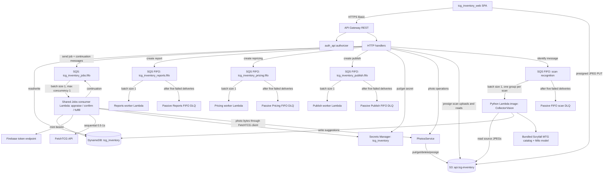
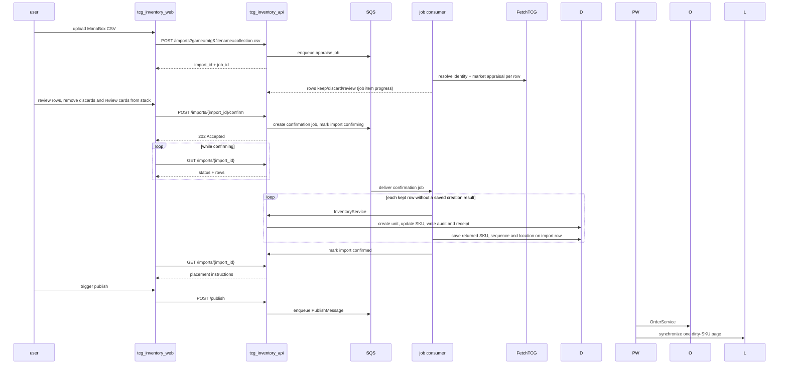
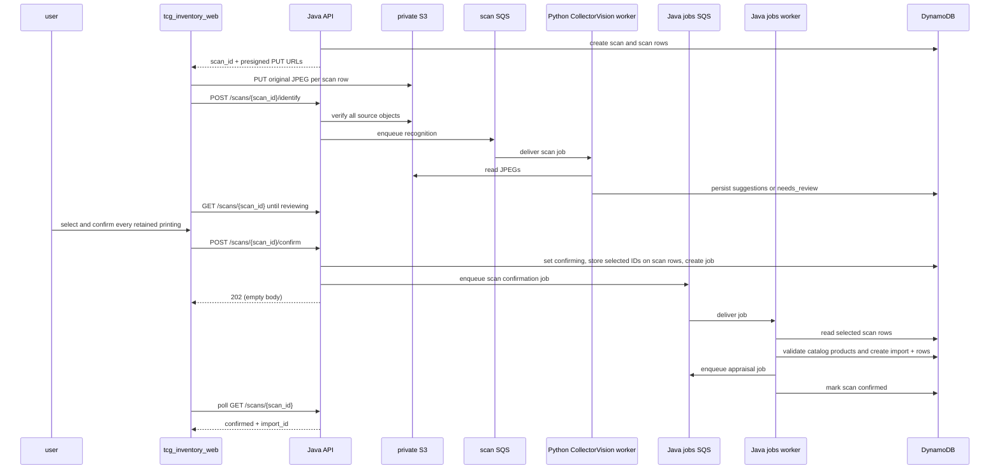

# TCG inventory API

The TCG inventory API service is the source of truth for physical Magic: The Gathering and English Pokémon stock stored under chaos sorting, projecting in-stock units to FetchTCG listings and mirroring FetchTCG order activity back as reservations, pulls, and releases. Pokémon inventory starts empty because its import and scan capabilities are disabled.

## Overview

- **Service type**: backend API (`tcg_inventory_api`)
- **Interface**: REST over HTTPS plus an SQS-driven job consumer
- **Runtime**: AWS Lambda (Java 21) behind API Gateway REST; Java SQS consumers for shared jobs and vertical-owned Reports, Pricing, and Publish; Python CollectorVision Lambda image for scan recognition
- **Primary storage**: DynamoDB table `tcg_inventory` with `gsi1`, `gsi2`, and `gsi3`; S3 bucket `api.tcg-inventory.jordansimsmith.com` (physical photos under `users/<user>/photos/`, source scans under `users/<user>/scans/`)
- **Auth model**: API Gateway custom REQUEST authorizer provided by the shared `auth_api` service (see `auth_api/README.md`)
- **External integration**: FetchTCG website API (unofficial), Firebase token exchange, offline CollectorVision Scryfall MTG catalog, live Scryfall catalog lookup for Magic card review, TCGCSV Pokémon catalog source, and TCGplayer card images for Pokémon inventory
- **Primary consumer**: `tcg_inventory_web`

## User stories

- As a card seller, I want to import a ManaBox scan, review each card's keep/discard appraisal in stack order, and confirm keepers into inventory with assigned storage locations, so that intake requires no physical sorting.
- As a card seller, I want to upload an ordered batch of card-front JPEGs, verify every exact printing, and create an ordinary import, so that a document scanner can replace ManaBox identification without changing appraisal or placement.
- As a card seller, I want scan uploads and recognition suggestions to survive browser closure, so that an interrupted review does not require rescanning the cards.
- As a card seller, I want FetchTCG listing quantities to always equal my in-stock unit counts, so that I never oversell or list phantom stock.
- As a card seller, I want cards appraised at NZ$20 or more to require photos captured during import review and projected onto their FetchTCG listings, so that high-value listings show the actual card the buyer receives.
- As a card seller, I want accepted offers to reserve the exact physical units and paid orders to produce a location-ordered pull sheet, so that fulfilment is one forward pass through my boxes.
- As a card seller, I want to see whether an accepted offer's price differs from my listed price, so that I can tell a lowball or over-ask from a buy-at-list sale.
- As a card seller packing an order, I want the buyer's name, delivery address, and the postage option they paid for, so that I can address and post the parcel without opening FetchTCG.
- As a card seller, I want every inventory mutation audited with before/after state, so that digital counts never silently drift from the physical boxes.
- As a card seller, I want a regenerated overview report of value, movement, and composition, so that I can appreciate the overall state of the inventory without browsing SKU by SKU.
- As a card seller, I want to configure a per-user minimum price for new appraisal decisions, so that future imports reflect my pricing preferences.
- As a card seller, I want to reprice in-stock inventory using current market data and my saved floor, so that I can update existing listings before publishing them.
- As a cautious FetchTCG user, I want conservative sequential API traffic and fail-closed credential handling, so that automation risk stays minimal.

## Features and scope boundaries

### In scope

- Authenticated CRUD for imports: upload a ManaBox CSV, appraise rows asynchronously, review appraisal decisions, confirm keepers into inventory, delete unwanted imports before confirm. Import detail derives `total_suggested_price` from keep-row suggested prices.
- Scanner intake: create a batch with a registered game, one condition (`NM`, `LP`, `MP`, `HP`, or `DMG`), and a finish allowed for that game; upload one ASCII-named JPEG front per card, identify with the configured offline catalog, explicitly confirm each retained printing, and create one ordinary appraising import. Magic (`mtg`) is the only game enabled for intake and uses the offline CollectorVision catalog. Pokémon (`pokemon`) is registered with scanning and CSV import disabled. Ascending filenames are bottom-to-top, and the first scanned row becomes the first import row. Alternate art, double-faced cards, and tokens are supported for Magic.
- Game metadata: authenticated `GET /games` returns Magic and Pokémon English with display names, ordered finish choices, scanning/CSV-import capabilities, and image regions used by scan review. Pokémon advertises disabled intake capabilities and three review regions: set and collector number, left artwork stamps, and right artwork stamps.
- Review catalog: authenticated catalog endpoints return exact Magic printing details, related printings, and finish-filtered name or ID search from Scryfall. Pokémon exact product details, finish-filtered name search, and exact-full-name alternatives come from the latest published TCGCSV snapshot. The browser scan review continues to use the Magic endpoints.
- Pokémon inventory: `pokemon` uses source `tcgplayer`, TCGplayer product IDs as `external_id`, and the `normal`, `holofoil`, and `reverse_holofoil` finishes. Inventory browse and audited adjustments, publishing, order reservation and fulfillment, and report attribution use the shared game-aware workflows. A Pokémon SKU ID has the same form as Magic: `pokemon#tcgplayer#<tcgplayer_product_id>#<finish>#<condition>`; its exact finish-specific FetchTCG card ID remains stored separately for publishing. Pokémon stock creation, imports, and scanning remain disabled.
- Pokémon catalog: the catalog library fetches and normalizes TCGplayer Pokémon category `3` records from TCGCSV into deterministic schema-version-1 snapshots, publishes them to S3 with DynamoDB registry entries, and loads the latest snapshot lazily for exact detail, batch lookup, finish-filtered name search, and exact-full-name alternatives. This read-only catalog does not enable Pokémon intake.
- Durable scan jobs and source images: all-or-abandon batch uploads, background recognition with stored suggestions, manual correction through the authenticated catalog endpoints, irreversible removal of an outlier scan row, deletion of an unfinished job, and read-only confirmed jobs. Confirmed source scans are retained indefinitely and never automatically used as listing photos.
- Per-user pricing configuration: authenticated `GET /pricing` returns the effective price floor, and `PATCH /pricing` saves a per-user override through PricingService. An unset override reads as `0.25`; once configured, it cannot be cleared through the API. Invalid values return 400. Floor writes are allowed during background jobs; each `PricingService#getPrice` call reads the current floor, so repeated items in one job batch can observe a changed override.
- Appraisal per row: FetchTCG identity resolution for the submitted ManaBox or scan-confirmed printing (candidates verified against the row's Scryfall ID, cached on the SKU after first sight), followed by a Pricing service lookup for market and suggested prices. Imports applies its fixed keep filter to the returned market value. CSV and scan-confirmed imports use the same appraisal worker.
- Inventory reads: `InventoryService#findSkus` and `getSku` return a common SKU contract with pricing, FetchTCG identity, listing ID, and version fields. `GET /skus` requires a game and pages browse results; `GET /skus/{sku_id}` returns `{ "sku": ... }`. SKU detail and exact unit reads are strongly consistent; listings use eventually consistent indexes. Internal `findSkus` requests can list every game or query dirty/clean SKUs. These modes are exclusive: dirty mode cannot be combined with game or search. Each call returns one page; callers follow continuations even when a page is empty. The operation does not claim dirty SKUs. `GET /skus/{sku_id}/units` separately returns physical units, derived locations, and ordered photo IDs. These reads do not call Catalog or query units from SKU detail.
- Inventory unit reads: `InventoryService#findUnits` returns one strongly consistent page of physical units, while `getUnit` reads one unit by SKU and sequence number with a strongly consistent exact-key lookup. Both return derived location, typed status, creation epoch seconds, nullable update epoch seconds, ordered physical-photo IDs, and nullable `reservation_id` stored directly as `reservation_id`. The listing limit is 1–100 and defaults to 100; callers follow `next_continuation` across live pages. Removed units are omitted from listings and return not found from `getUnit`. Photos resolves photo IDs into short-lived URLs.
- Inventory unit-location reads: `InventoryService#findUnitLocations` accepts up to 100 `(sku_id, sequence_number)` references and returns locations for physically present targets in input order, preserving duplicates. Targets that are sold, removed, or absent are omitted because they have no current physical location. For each returned target, it reports the assigned location, current position among in-stock or reserved units in the same game's storage block, and nearest physically present previous and next cards. SKU reads are strongly consistent; block-index reads are eventually consistent, so results are live observations rather than a snapshot. A request reads each input SKU reference, every page for each distinct game/block, and the SKU for each returned neighbor. It performs no writes or provider calls.
- Listing photos: up to 5 JPEG photos per keep row, captured during import review (raw-body upload, stored durably in S3, served via short-lived presigned URLs); confirm is blocked while any keep row appraised at NZ$20+ has no photos; photos freeze onto units at confirm and are immutable afterwards.
- Manual audited adjustments: remove a unit through `InventoryService#deleteUnit`; change its condition through `InventoryService#updateUnit`. A successful move preserves the unit sequence, creation time, and ordered photo IDs, updates its time, marks both SKUs dirty, and writes one adjustment audit. Request and SKU contracts use `inventory.client.Condition`; stored values remain the same uppercase strings. An unchanged condition succeeds without writes. Inventory uses Games metadata to validate the finish and derive the destination SKU ID. A missing destination is initialized from the source; an existing destination retains its metadata and price. A retry against the old SKU after a completed move can return 404.
- Publish: `PublishService` owns admission, status, and dispatch. Creation conditionally saves a queued run before sending a private `PublishMessage` to `tcg_inventory_publish.fifo`; a dispatch failure leaves the run queued for manual recovery. Repeated creates while queued or running return acceptance without another send. On the first page, `PublishMessageHandler` calls `OrderService#updateOrders` synchronously, then synchronizes one dirty-SKU page through Listings and checkpoints successful calls before sending a continuation. `PublishWorkerHandler` consumes one internal message per invocation. Status returns `queued`, `running`, or `succeeded`, the checkpointed published count, acceptance time, nullable completion time, and live pending count; there is no public run ID or processing error, and GET returns 404 before the first Publish-owned run. Pending counts use Inventory's eventually consistent dirty index. Worker failures retry up to five receives and then reach the passive DLQ; engineers recover stranded runs manually. Earlier Listings effects may repeat after an uncheckpointed failure, and the published count can understate those effects. The configured HTTP handlers use this owner-local runtime. Before deploying the cutover, drain or resolve queued/running legacy Publish jobs and continuation messages; retained generic job records are historical only.
- Repricing: PricingService owns admission, latest-run status, page checkpoints, and queue dispatch for authenticated `POST /pricing/reprice` and `GET /pricing/reprice`. Repeated starts for a queued/running run return bodyless `202`; one active Pricing run is allowed per user, while unrelated workflows can run concurrently. The dedicated worker processes one page of up to 100 Inventory SKUs per message and records checked candidates only after the complete page succeeds. Earlier price writes may repeat after a later candidate fails. Failures retry through SQS and then reach the passive DLQ; stranded runs require manual recovery. The GET response contains status, checked count, acceptance time, and completion time, with no public run ID or error field.
- Pull sheets for paid orders, sorted by game and then unit sequence number. While an order is `to_pick`, each allocated card includes its offered per-unit price, game and external identity, current block position (gaps from sold and removed cards collapsed), and neighboring cards in the same game's block. Other order states retain allocated-card details without location data. Confirming a pull queues background fulfillment and reports completion after every allocated unit is sold.
- Offer vs listed price: each ingested offer line stores the FetchTCG listing's `listedPrice` at ingest time; `GET /orders` returns item and listed subtotals (shipping excluded) and `GET /orders/{order_id}` returns the same subtotals plus per-line offered and listed prices.
- Fulfillment details on orders: the buyer's display name, delivery address, and selected postage option are captured from the offer and refreshed on every order-phase run, so `GET /orders/{order_id}` carries what packing a parcel needs.
- Reports: the public `reports.client.ReportService` contract defines typed create and read operations and the existing JSON payload, including queued/running/succeeded generation metadata. Reports owns a singleton item and repository for the snapshot and current generation. Its service operations conditionally admit one queued or running generation per user, save the internal message before dispatch, and read the previous snapshot while regeneration is in progress. Its server processes queued or running generations, recalculates the full snapshot, and atomically saves the snapshot with succeeded state. The `/reports` handlers call this service, and the dedicated `ReportWorkerHandler` consumes one private `ReportMessage` at a time from `tcg_inventory_reports.fifo`; failed invocations retry up to five receives and then reach the passive `tcg_inventory_reports_dlq.fifo`. Recovery is manual, and a calculation failure preserves the prior snapshot and leaves the generation running. Reports no longer uses the shared Jobs dispatcher or records. Report generation aggregates the entire inventory into a stored dashboard snapshot with combined headline totals, activity trends, and a stock breakdown for every registered game.
- Per-user FetchTCG refresh-token storage with masked reads; seller-offer reads, listing updates/deletions, and image uploads use the private token provider, which reuses a bearer while valid and persists rotated refresh tokens. Appraisal and repricing use saved seller metadata and do not exchange tokens.
- The Photos client/server/API packages own JPEG object creation, byte reads, deletion, and 15-minute download URLs in the existing user-scoped S3 key layout. Imports and Inventory store ordered photo IDs only. `InventoryService#findSkus`, `getSku`, `findUnits`, `getUnit`, `findUnitLocations`, `deleteUnit`, `updateUnit`, and `updateSku` expose SKU metadata and unit facts to their callers. Price-only SKU patches retain last-write-wins persistence, dirty/version changes, and price audits. `updateSku` also accepts a versioned dirty-state patch: `dirty=false` clears only the matching dirty version, while `dirty=true` marks it dirty and increments the version. These patches emit no audit. A stale version or already-clean acknowledgement propagates DynamoDB's conditional-check failure so the caller can retry or surface the conflict. Publishing reads dirty candidates through Inventory and delegates synchronization and versioned dirty clearing to Listings. Reports reads SKUs and orders through their client services; order-list reads include the line data needed for report revenue attribution. Order detail composes saved order rows with Inventory client results and does not access Inventory persistence models.
- Inventory owns an append-only audit log written transactionally with stock and price mutations. Orders lifecycle transitions do not write Inventory audits. Reports freshness depends only on snapshot age, so changes can remain unreflected until the user regenerates the report.

### Out of scope

- Marketplaces other than FetchTCG; games other than Magic: The Gathering and English Pokémon; non-English cards (they become review rows).
- Camera capture, PNG/TIFF/PDF scans, non-English/non-Magic recognition, scan quality grading, automatic per-image recognition retries, and using source scans as listing photos.
- Post-confirm photo editing (photos freeze at confirm; remove and re-import is the retake path) and FetchTCG buyer photo requests.
- Cost/purchase-price tracking and profit reporting (reports cover revenue and valuation only), bulk lots, master sets, POS, buylist.
- Background/scheduled polling of FetchTCG (all jobs are manually triggered).
- Deleting SKU records (they are permanent once created) or offer negotiation (accept/counter/reject happens on FetchTCG).

## Architecture

The [modular monolith engineering strategy](docs/modular-monolith-strategy.md) documents the target service boundaries and migration approach. This README describes the current implementation.

FetchTCG has an `api` package for its HTTP handlers, a public `client` package for service contracts, and a restricted `server` package for operations, provider adapters, persistence, and the bundled Magic set mapping resource. `FetchTcgModule` provides an anonymous service delegate; the top-level application module includes it, and the application factory exposes only `FetchTcgService`. Production callers outside FetchTCG use the client contract. The mapping JSON ships only with the server target at its existing classpath path. The server target allows the top-level Bazel package because application wiring remains there. Since business targets still share that package, this is a temporary visibility gap until they move into vertical packages or shared libraries under `//lib`.

Pricing exposes a public `client` contract, API handlers for floor settings and repricing, and a restricted `server` package. `PricingModule` provides an anonymous `PricingService` delegate, and the application factory exposes only that client plus the message handler for Pricing's worker adapter. Pricing owns floor reads and writes, verified seller lookup, FetchTCG marketplace reads, competitor aggregation, price policy, repricing admission/status, run persistence, page checkpoints, and message dispatch. Appraisal and repricing call `getPrice`; the message handler processes one Inventory SKU page per delivery and checkpoints only after every candidate succeeds. The checked count includes candidates skipped for having no in-stock units. Earlier price writes may repeat when a later candidate fails. Checkpoints are saved before continuation dispatch, so a failed send leaves durable progress for redelivery or manual recovery. `PricingWorkerHandler` consumes the Pricing FIFO queue. Application wiring supplies the typed queue client; production resolves the provisioned SQS queue, while tests use `FakeQueueClient`. Repricing does not create shared Jobs records.

Inventory's internal `createUnit` operation accepts an opaque `operation_id`, game/external identity, finish, enum condition, descriptive metadata, optional price and FetchTCG card ID, required FetchTCG set ID, and ordered photo IDs. It returns only `sku_id`, `sequence_number`, and `location`. Games supplies identity metadata; creation makes no Catalog, Photos, Pricing, or provider calls. Missing SKUs initialize from those inputs; existing SKU metadata and price remain unchanged. Each new arrival marks the SKU dirty and increments its version. New units are in stock with a creation timestamp and no update timestamp or reservation owner.

Creation first strongly reads the user-scoped receipt at `USER#<user>#INVENTORY` / `OPERATION#CREATE_UNIT#<operation_id>`. A replay returns its original three-field result before validating replacement creation inputs, even after the unit moves or is removed. Receipts retain standalone user/operation identity and have no expiry. For a new operation, one atomic counter increment allocates a user/game sequence using the existing counter; one four-item transaction commits the unit, SKU bookkeeping, `create` audit, and absent-only receipt. Transaction failures propagate; callers retry with the same operation ID. Allocation can leave sequence gaps after failure.

Inventory owns SKU and unit mutations, sequence/location allocation, creation and allocation receipts, reservation lifecycle, and transactional audits for its stock and price changes. It selects a unit for each `reserveUnit` call; Orders persists each returned sequence in its own order progress. Imports creates units one row at a time and persists each returned placement on the import row. Stock is visible as each operation succeeds, and sequence gaps or interleaving between rows are allowed. Callers recover by retrying the same operation ID; there is no cross-vertical transaction or automatic rollback. Orders uses Inventory for reservation, release, sale, fulfillment ownership checks, and cancellation. Listings owns marketplace synchronization and listing associations, then acknowledges the captured Inventory version through `updateSku`.

`GET /orders` and `GET /orders/{order_id}` are served by the Orders client/server/API packages. Orders owns the order and row reads, subtotal calculation, buyer details, and response composition. Exact order reads are strongly consistent; order listing remains eventually consistent. For `to_pick` orders, Orders asks `InventoryService#findUnitLocations` for allocated units in sequential batches of at most 100. For other states it reads each allocated SKU through `InventoryService#getSku`; location and neighbor fields are null because those states do not need a current pull sheet. Every saved allocation remains in the response in every state. Catalog images are composed by the frontend from the returned game and external card ID. Reports uses Inventory client reads for stock valuation and Orders client reads for paid revenue. A report is marked stale only after it is more than 24 hours old; intervening changes do not update its freshness status. The remaining Inventory access is through its client. Orders server contains a fulfillment message handler that sells the saved allocations through Inventory and completes the order after all sales; it is not wired to production yet. Confirmation and fulfillment still run through the legacy root handler and shared Jobs runtime. The root package's server-visibility gap remains.

Import confirmation processes kept rows in their saved order and calls `InventoryService#createUnit` once for each row without a saved result. Its stable operation ID is `import:<import_id>:row:<position>`. After each successful Inventory call, Imports stores the returned SKU ID, sequence number, and location together on the row before continuing. If Inventory committed but row progress did not, the next job delivery repeats the same operation and receives the original placement receipt without creating another unit or audit. Stock appears as each row succeeds; an import is marked confirmed only after all kept rows have durable results. Sequence gaps and interleaving with other stock creation are allowed, and placement instructions use the saved locations. Confirmed rows created before per-row results were stored are backfilled from their saved sequences and matching Inventory units; their SKU field uses the unit's current SKU ID.

Listings has public client and restricted server packages. `ListingsModule` provides `ListingService`, exposing single-SKU synchronization through `updateListing` and historical association lookup through `findListings`. Listings owns the current SKU-to-listing pointer and retained listing-ID-to-SKU associations in two record types in the shared table. `findListings` accepts up to 100 IDs, scopes reads to the authenticated user, deduplicates in request order, and omits unknown IDs. Both lookup records use strongly consistent reads; old associations remain after replacement or deletion of the current pointer. Publish delegates synchronization to Listings. Orders resolves new accepted offers through user-scoped Listings associations, including retained historical IDs.

Orders uses the Inventory client for unit selection/reservation, cancellation releases, fulfillment ownership checks, sales, and order-detail SKU/location reads. Orders retains saved allocation progress but does not write Inventory records. Both read endpoints use Orders-owned read models; `GET /orders` returns the list projection and line SKU/price facts, while detail composes allocated cards and, only in `to_pick`, Inventory's current location and neighbor facts. Inventory failures propagate rather than producing partial location data.

`OrderService#updateOrders` is a synchronous client operation with an empty request and response: success means all Orders work completed. It paginates every FetchTCG offers page, reads tracking settings and existing orders, and completes new-offer preparation before applying existing-order transitions or creating reservations. It resolves distinct listing IDs through `ListingService#findListings` in sequential batches of at most 100; empty input makes no lookup, and each nonempty batch makes one service request. A later offers or association failure prevents provider-derived transitions and new reservations from using partial input. Missing associations retain the actionable conflict message. Existing `reserving` and `voiding` work then resumes in order, followed by reservations for new orders. Each unfinished reserved unit makes one Inventory request and one conditional Orders progress transaction. Publish invokes this synchronous operation before listing work on its first page.

Each priced item costs one strongly consistent floor read, one FetchTCG account-metadata read, one card-detail request, and one listings request for each page. Pricing makes no profile or Firebase calls and adds no retries beyond FetchTCG's own bounded retries. At one listing page per item, 100 priced items make 200 paced public requests, or about 100–200 seconds of pacing before network and storage time. There is no price or floor cache or batch snapshot. Appraisal additionally performs its own identity-resolution searches and candidate-detail reads, then independently fetches the resolved card again through Pricing.

Account reads return saved metadata from DynamoDB only; credential updates verify the submitted token and profile, write the effective refresh token to Secrets Manager, then write the verified username and save time to DynamoDB. Those writes are not atomic: if metadata persistence fails, the HTTP request fails after the token may already have been saved. Public card-detail, paginated card-search, set-mapping, and listing reads do not require marketplace credentials. Appraisal resolves printing identity through FetchTCG, then calls Pricing for authoritative market and suggested prices; repricing calls Pricing once per eligible in-stock SKU. A price lookup makes no profile request or token exchange. Order processing reads offers through `FetchTcgService#findOffers`, which uses the private token provider; it does not require account metadata or make a profile request. Listing publication uses the service for absolute-quantity updates, deletions, and image uploads; already-absent listings count as successful deletes. Authenticated operations share the token provider, which retries 5xx responses up to three times after the initial request and persists rotated refresh tokens before returning a bearer. Listings reads selected photo bytes through Photos and passes them to FetchTCG for upload; FetchTCG has no Photos dependency. Returned provider image URLs are used for the current listing update and are not persisted, so each publish attempt uploads the photos again and can create duplicate remote images. Users whose tokens were saved only through the legacy settings flow may continue to use them for authenticated FetchTCG operations, but must re-save through `PUT /fetchtcg/credentials` to establish verified metadata required by pricing. Set mapping makes zero provider requests. Orders owns order-tracking preferences; the existing Games endpoint is the application login probe.



The new `catalog.client` and `catalog.server` packages provide `CatalogService#findCardImages`; the top-level application module includes the server module, which uses the Games client to choose image URL formats. `GET /catalog/cardimages` is a thin API adapter. SKU and order detail responses retain the game and external card ID for frontend image composition; the order API does not generate or return card image URLs. The legacy catalog library still owns provider clients, catalog lookup, request pacing, and snapshot persistence, and its adapters temporarily depend on the new server's pure URL formatter so image URL rules have one implementation. The legacy catalog library still depends on shared root wiring; it is not the dependency of the new server. Legacy Catalog handlers retain `CatalogFactory`, which supplies `FakeCardCatalogs` in integration tests, and focused adapter tests use a loopback HTTP server. The catalog storage bucket constant is independent of photo storage configuration.

### Concurrent synchronous edits

Import review mutations require an existing parent in `review` within the same DynamoDB transaction as the row write. Confirmation validates strongly read keeper rows and required photos before conditionally transitioning from `review` to `confirming`. Review edits made between photo validation and that transition are accepted; no version or snapshot check is performed. Import-row photo updates use last-write-wins semantics, while requiring the row to exist and its parent to remain in `review`. Initial lifecycle validation still returns the existing `404`/`409` responses. Import deletion conditionally removes the review parent first and then attempts row cleanup; cleanup failures propagate through the normal internal-error path even though the parent has already been removed. Orphaned rows are inaccessible without their parent.

The confirmation worker creates each kept row through Inventory and saves the returned SKU ID, sequence number, and location on that row before proceeding. Inventory’s stable creation receipt makes a retry safe if stock creation committed but saving row progress failed. New stock is visible as rows complete; no cross-service transaction joins row progress to unit creation. Confirmed imports created by the legacy worker are backfilled by matching their saved sequence numbers to current Inventory units and deriving their locations. If a unit's condition has changed since import, the backfilled SKU ID is its current SKU. The detail handler requires the stored SKU and location and has no sequence-formatting fallback. The placement backfill is defined in `migrations/005-backfill-import-unit-results.py`; runtime detail reads require saved SKU and location results.

Photo uploads precede attaching their references; reference removal precedes S3 deletion. Failed attachment or cleanup may leave unreferenced objects. Publication reads selected photo bytes through Photos and sends them directly to FetchTCG. It does not write remote URLs onto units. Each publish attempt can upload duplicate remote images; no deduplication or cleanup protocol exists.

Configuration may change during jobs. Repricing can fail on version conflicts or have prices replaced by later writes; users can rerun it. Reports can combine observations from different moments. Marketplace quantities, conditions, and images can remain stale until another publish. Physical stock discrepancies and invalid saved order allocations can require manual intervention. These operations do not acquire a global mutation lock.

### Primary workflow



### Scanner workflow



## CollectorVision image

The image is an amd64, digest-pinned AWS Lambda Python 3.12 OCI image that loads CollectorVision, opens the pinned local v40 catalog with `Catalog.load(..., offline=True, version=40)`, and initializes its CPU ONNX Runtime/Milo embedder and bundled Cornelius card-corner detector. The production handler processes SQS scan messages and uses only packaged models and catalog data at runtime.

The `collectorvision_image` macro in `collectorvision.bzl` owns the cache metadata, catalog downloads, direct Milo download, license layer, Python dependency layer, application layer, image labels, and image-load target. `BUILD.bazel` only invokes that macro. Records, embeddings, and Milo are all checksum-pinned Bazel downloads; Milo is downloaded directly from the pinned CollectorVision commit rather than extracted from the Python wheel.

The image uses `COLLECTORVISION_CACHE=/opt/collectorvision` and the v40 cache layout expected by CollectorVision. Python dependencies, including CPU-only `onnxruntime==1.19.2` and its transitive native dependencies, are installed at the Lambda-standard `/var/task` root, alongside the worker application, so `collector_vision` imports normally without a `PYTHONPATH` or runtime `sys.path` modification. The repository's Python 3.12 toolchain, dependency lock, and Lambda base image are intentionally aligned; the AL2023 Lambda base supplies the glibc version required by the pinned ONNX Runtime wheel without a compatibility-library layer. The package is pinned to commit `2a122d00d25c8d112a90e47bf235a021e0c53b0c`; the 5,191,100-byte Milo download is pinned by SHA-256, and the CollectorVision AGPL-3.0-or-later license is included in the image.

Build the image with `bazel build //tcg_inventory_api:scan-worker-image` and load it with `bazel run //tcg_inventory_api:scan-worker-image-load` for local smoke checks. The `scan-worker-image.digest` target is the authoritative manifest digest, and `scan-worker-image-push` pushes the same OCI layout by digest when given an ECR repository. The Terraform deployment runner creates the manifest-declared ECR repository through boto3 when it is absent, obtains ECR credentials in an isolated Docker config, and passes the resulting `repository@sha256:<digest>` to Lambda. ECR repositories are retained outside Terraform lifecycle; Terraform owns the Lambda retrieval policy and consumers. The worker initializes the pinned catalog and Milo embedder with `offline=True`, reads `SCAN_TABLE_NAME` and `SCAN_BUCKET_NAME`, and resolves the fixed `tcg_inventory_scan_jobs.fifo` queue when it needs to continue a batch.

The deployed worker is an x86_64 image Lambda with 1769 MB memory, a 900-second timeout, and a 30-day CloudWatch log group. Its source queue keeps a 960-second visibility timeout and max receive count 5. The immutable, scan-on-push ECR repository and separate worker role are limited to scan-object reads, the required DynamoDB reads/writes, source-queue delivery and continuation operations, and basic logging; the role has no DLQ access. Terraform pins the Lambda image to the pushed digest; the platform alarm observes both the ordinary job DLQ and the passive scan DLQ, while no DLQ consumer performs recovery.

The shared `infra/modules/container_lambda` module owns the generic image-Lambda role, basic logging policy, explicit log group, published function, and optional event-source mappings. The deployment runner owns creation of the scan-specific ECR repository; this service supplies its retrieval policy, worker data policy, queue, and environment values through Terraform.

## Main technical decisions

### Java package layout

The Inventory client exposes `findUnits` and `getUnit` with a `UnitStatus` enum serialized as `in_stock`, `reserved`, `sold`, or `removed`. Inventory omits removed units from both responses. Unit timestamps are required epoch-second `created_at` and nullable epoch-second `updated_at` values. `findUnits` performs one strongly consistent DynamoDB page read; consumers follow continuations and may observe changes between pages. `getUnit` performs one strongly consistent exact-key read. `updateSku` applies a nullable price patch, stores it as a two-decimal suggested price, marks the SKU dirty, increments its version, and writes an audit in the same transaction. It also accepts dirty-only patches with the caller's captured version: `dirty=false` conditionally clears the matching dirty version, and `dirty=true` conditionally marks it dirty and increments the version. A stale version or already-clean acknowledgement propagates DynamoDB's conditional-check failure; dirty-only patches never write an audit. Repricing and Reports read SKUs and units through Inventory; repricing applies prices with `updateSku`, while Reports values stock from the current nullable `Sku.price()`. SKU listing reads use an eventually consistent index and live pagination; unit reads are strongly consistent. Publishing uses Inventory reads and delegates listing effects to Listings.

The Java API is organized into hard-boundary vertical packages. `games` owns the immutable registered game and finish metadata, its client contract, and the `GET /games` HTTP adapter; `catalog` owns normalized catalog models, provider adapters, catalog dependency injection, card detail, alternatives, search, and the `findCardImages` service/API operation; `scans` owns scan records, recognition messages, scan persistence, and scan handlers; `imports` owns ManaBox parsing, appraisal, import records, photos during intake, and import handlers; `inventory` owns SKUs, units, locations, sequence allocation, price patches, inventory mutation audits, and inventory handlers; `orders` owns offer ingestion through `OrderService#updateOrders`, reservations, fulfillment, order persistence, and order handlers; `reports` owns report records, aggregation, generation, and report handlers; `publish` owns publication admission, status, orchestration, checkpoints, and its dedicated worker runtime; and `pricing` owns floor configuration, the public pricing service, price calculation, repricing run persistence, repricing message processing, and its dedicated worker runtime. Shared Dagger configuration, remaining generic jobs, photo policy/storage helpers, and table constants remain in the top-level package.

Bazel gives each migrated vertical separate `api`, `client`, and `server` packages. Vertical consumers depend on public client contracts; root composition and dedicated adapters/tests receive only the restricted server access needed for wiring. The root package still contains business targets, so its server visibility remains an enforcement gap until those targets move into their own packages. Publish server operations call Orders, Inventory, and Listings through their clients. `JobsHandler` no longer constructs or dispatches Publish processing; remaining shared job processors are composed there until their own migrations.

### Pokémon catalog preparation

`catalog-lib` contains the typed `TcgCsvClient`, its HTTP implementation, the Pokémon category normalizer, immutable snapshot records, the JSON/gzip codec, and the lazy TCGplayer catalog adapter. The legacy `catalog.CatalogModule` supplies the Scryfall and TCGCSV clients through constructors, sharing one HTTP client while giving each client an independent request pacer. The new `catalog.server.CatalogModule` provides the URL-only image service using Games metadata. Legacy provider adapters temporarily depend on the new server only to reuse the pure URL formatter; the new server does not depend on the legacy catalog library. It also composes snapshot storage and registers adapters by game ID (`mtg` and `pokemon`), even though both inventory and Pokémon use external-source identities to form SKU IDs. The TCGCSV client uses `/last-updated.txt`, `/tcgplayer/3/groups`, `/tcgplayer/3/{group_id}/products`, and `/tcgplayer/3/{group_id}/prices`. It sets a descriptive User-Agent, a 3-second connection timeout and a 10-second request timeout, and serializes requests through an injected `Runnable` pacer that enforces at least 100 ms between request starts. Collection status, envelopes, supplied counts, and the offset timestamp must parse successfully. The normalizer is bound to Pokémon category `3`, returns `TcgCsvCatalogSnapshot` directly, and throws immediately on invalid or duplicate source identities, invalid price joins, blank or duplicate subtype names, malformed extended data, or conflicting Card Type/Number metadata. It validates and normalizes products and prices within each group. The `CatalogSnapshotStore` writes immutable compressed artifacts to the service bucket and publishes their metadata through `CatalogRepository`.

The snapshot records `schema_version`, `game`, `external_source`, `catalog_source`, `category_id`, `snapshot_id`, `source_marker`, `source_updated_at`, `created_at`, `groups`, and `products` in that order. The marker preserves its source text and parsed UTC instant; `snapshot_id` is that instant in ISO UTC form and the two time fields are UTC epoch seconds. Groups sort by numeric group ID, products by numeric TCGplayer product ID, and finishes by `normal`, `holofoil`, `reverse_holofoil`. The minified JSON and gzip are byte-stable when their source records and supplied timestamps are identical. Products keep their numeric TCGplayer product ID, full name, group ID, collector number, and available finishes. The existing TCGplayer adapter derives thumbnail and large-image URLs from that ID (`<product_id>_200w.jpg` and `<product_id>_in_1000x1000.jpg`); the snapshot stores no image URL or image data, numeric price, or gameplay text.

Eligibility requires a group with a nonblank abbreviation, a product with nonblank `Card Type` and `Number` fields, and at least one supported finish. Any nonblank Card Type value is accepted without a value allowlist. A missing, empty, or whitespace-only abbreviation excludes the group and its products; missing or blank Card Type or Number excludes the product. These are intentional eligibility exclusions, with no group or product exceptions. Rarity, HP, and other card fields do not affect eligibility. The normalizer maps only `Normal`, `Holofoil`, and `Reverse Holofoil`; a price row establishes finish availability even when its numeric prices are null. Other nonblank subtype names, including edition-specific subtypes, are ignored. Products with no supported finish are excluded.

Category `3` is primarily English Pokémon but includes some foreign-language promos and other special products. Eligibility does not inspect names, language, rarity, or special group IDs. Numbered jumbo cards, numbered World Championship replicas, and numbered multi-card V-UNION products can therefore be included. For example, `Pikachu (Italian)`, `Mabosstiff ex - Jumbo Card`, and a numbered `Morpeko V-Union [Set of 4]` are retained when they have Card Type, a group abbreviation, and a supported finish. `Jumbo Ice Cream` is retained under the same rules. Unnumbered energy and promos, and groups such as My First Battle with no abbreviation, are excluded. Audited sealed products, code cards, and merchandise lack the required card metadata and are excluded on that basis.

A complete source pull checked the update marker before and after collection; both were 2026-10-07T20:06:09+0000. It covered 220 groups, 32,858 product rows, and 45,436 subtype rows across 443 paced requests. The normalized snapshot has 216 groups, 25,600 included products, and 7,258 excluded products. The snapshot contains 14,968 products with normal, 9,990 with holofoil, and 13,344 with reverse_holofoil (finish counts overlap). Every included group has a nonblank set code and every included product has a nonblank collector number. The minified snapshot measures 3,494,346 bytes and gzip measures 371,782 bytes. Reordering the source collections preserves identical JSON and gzip bytes.

Pokémon intake remains disabled. Scan confirmation currently requires nonempty `name`, `set_code`, `set_name`, and `collector_number`; that validation must be revisited before enabling Pokémon intake. The catalog excludes products without a collector number and groups without an abbreviation.

#### Snapshot storage and publication

Each catalog snapshot is stored as gzip-compressed JSON at `catalogs/tcgcsv/<game>/snapshots/<snapshot_id>.json.gz` in the existing `api.tcg-inventory.jordansimsmith.com` bucket. For Pokémon, a snapshot ID is the canonical UTC source timestamp at second precision, such as `2026-10-07T20:06:09Z`. Retries use conditional S3 writes; when that key already exists, the first stored artifact and its `created_at` are reused.

The `tcg_inventory` DynamoDB table is the publication registry. One immutable item is written only after the object is available:

```json
{
  "pk": "CATALOG#pokemon",
  "sk": "SNAPSHOT#2026-10-07T20:06:09Z",
  "game": "pokemon",
  "snapshot_id": "2026-10-07T20:06:09Z",
  "source_updated_at": 1791403569,
  "created_at": 1791403600,
  "s3_key": "catalogs/tcgcsv/pokemon/snapshots/2026-10-07T20:06:09Z.json.gz",
  "checksum_sha256": "<lowercase SHA-256 of the gzip bytes>"
}
```

The checksum describes the stored gzip bytes. Source identity, original marker, schema version, groups, and products remain in the artifact. Catalog creation trusts the normalizer's validation. Loading fetches, decompresses, and deserializes the object; it does not repeat schema, identity, count, or checksum validation. Latest discovery is a strongly consistent query of CATALOG#<game> ordered by the SNAPSHOT# sort key descending with a limit of one. An empty registry means no catalog is available. An S3 412 Precondition Failed reuses the existing object and completes registry publication. Other S3 errors, including 409 Conflict, propagate for retry. Upload or publication failures leave the previous latest record unchanged. A conditional registry conflict propagates; on retry, the strongly consistent exact lookup returns the winning record. Retries after a successful but unacknowledged registry write recover the same way. Published history and unregistered snapshot objects are retained indefinitely.

#### Catalog serving

`Catalogs` registers adapters by game ID: `mtg` uses Scryfall and `pokemon` uses the TCGplayer snapshot adapter. Constructing an adapter or deriving TCGplayer image URLs does not read the registry or download an artifact. The first Pokémon detail, nonempty batch lookup, valid search, or alternatives request reads only `CATALOG#pokemon` and loads its latest artifact into an immutable snapshot POJO. The artifact is trusted after decompression and deserialization; serving does not revalidate schema, game identity, counts, or checksum.

Each adapter checks its latest registry item on first use and then at five-minute intervals during active requests. It caches the deserialized snapshot POJO; an unchanged snapshot ID avoids another S3 read. A changed snapshot replaces the cached POJO only after it has loaded successfully. Each detail, batch, search, or alternatives operation captures one snapshot and traverses its products and groups to answer the request. A failed refresh returns `503` for that request and leaves the previous snapshot cached for a later registry check. Missing initial publication also returns `503`; no empty catalog is substituted. There is no source-age cutoff, so the last published snapshot remains available after a failed refresh worker run.

#### Catalog refresh processing

CatalogJobsHandler accepts one SQS message with a game and UTC scheduled_at timestamp. For example: {"game":"pokemon","scheduled_at":"2026-10-08T21:00:00Z"}. The worker currently accepts only pokemon, mapped to TCGplayer category 3. It reads the TCGCSV update marker and latest publication first; when that source timestamp or a newer one is already registered, it returns without downloading collections. Otherwise it fetches the groups and each group's products and prices sequentially, normalizes the full collection, reads the marker again, and publishes only when both parsed source timestamps match.

Every TCGCSV request has a 10-second timeout and at most four attempts. The client retries transport I/O failures and HTTP 5xx responses, calling its injected 100 ms pacer before every attempt. It fails immediately on 429, other non-5xx statuses, malformed responses, and interruption. After attempts are exhausted, the exception propagates to SQS. A new delivery repeats the full collection unless a snapshot was already published; there are no refresh progress records or source collection checkpoints. The daily schedule limits normal pulls, but the worker does not enforce a rolling 24-hour full-pull guard. The before/after marker check reduces version-crossing risk but does not prove TCGCSV's collections were an atomic upstream snapshot.

The worker publishes through CatalogSnapshotStore. A failed upload or registry write does not replace the previous latest snapshot. A later delivery uses the existing immutable-object and registry recovery behavior. Before the first successful publication, catalog lookup remains unavailable.

- Inventory is the source of truth; FetchTCG listings are an absolute projection: listing quantity = count of `in_stock` units per SKU. Re-importing already-listed cards converges to a no-op, and FetchTCG's own decrement at offer acceptance converges without a write.
- Dirty-marker outbox for the projection: every mutation transaction sets a plain boolean `dirty` on affected SKU records. Only mutation transactions can set the flag, which makes every FetchTCG write traceable to an audited inventory event; blind reconciliation never changes quantities. Coalescing is inherent because the projection is absolute. Publish discovers dirty SKUs through Inventory's eventually consistent index; a recent dirty SKU missed by one page remains dirty for a later run.
- Stock counts are neither stored nor included in SKU reads. Unit counts and statuses are read through the separate unit operation where needed. Every mutation transaction bumps a plain `version` number on the affected SKU (`ADD version :1`); Listings obtains the current unit count and acknowledges the dirty version through Inventory; a concurrent mutation makes the acknowledgement fail and leaves the SKU dirty for a later run.
- The `tcg_inventory` table remains a single physical-table storage contract, while each persisted record type has its own independent `@DynamoDbBean` schema. Inventory server owns `InventorySkuItem`, `InventoryUnitItem`, its sequence counter, operation receipts, reservation lifecycle, and Inventory audit records. Orders server owns its order and row read models. Other records include `ImportItem`, `ImportRowItem`, `ScanItem`, `ScanRowItem`, `OrderItem`, `OrderRowItem`, `JobItem`, `OrderSettingsItem`, `ReportItem` and `CatalogSnapshotItem`. Each bean owns its `pk`, `sk`, attributes, and applicable GSI keys. Object values used by only one record schema stay nested in that bean, including separate `Photo` value types for units and import rows even though their shapes currently match. Cross-record atomic operations continue to use low-level DynamoDB requests with the concrete table schema for each serialized item.
- SQS FIFO work queue with continuation messages: messages carry only `{user, job_id, job_type}`; the job item's `continuation` is authoritative. The shared Jobs queue uses one message group per user for legacy appraise, import-confirmation, and fulfillment work. Pricing, Reports, and Publish each own a FIFO queue grouped by run ID and can overlap shared Jobs and other vertical workers. Each message performs bounded work, checkpoints, and dispatches its continuation when more work remains.
- Synchronous inventory, import review, scan deletion, and settings mutations remain available during unrelated background work. Resource lifecycle checks still apply. Existing background-start admission checks and per-user FIFO execution remain unchanged; admission is best effort, and a rare duplicate publish is accepted.
- Batch messages for one job are byte-identical, so content-based deduplication is disabled and every send sets an explicit `MessageDeduplicationId` of `<job_id>#<processed_count>`: distinct batches are never deduplicated, duplicate re-sends of the same batch within the 5-minute dedup window are suppressed, and a send missing a dedup ID fails loudly instead of silently swallowing a continuation.
- Duplicate SQS delivery is expected and absorbed: batches read the job item fresh, DynamoDB effects are conditionally guarded, FetchTCG listing updates send absolute quantities keyed by `cardId` + condition, and deletes converge when the provider reports the listing is already absent. Mutations retry up to three times after the initial attempt on 5xx responses, with pacing before each attempt.
- Job checkpoints store `continuation` as a nullable opaque DynamoDB string and `processed_count` as a separate cumulative integer. Each shared-job processor owns continuation encoding and decoding: appraisal uses a decimal row position and single-invocation jobs return null. Publish uses its owner-local persisted cumulative listing count for continuation dispatch. New jobs start without a continuation. A success result with a null continuation finishes the job; a non-null continuation requests another batch. The shared handler neither parses nor orders tokens. It saves the token, count, status, and timestamp together before sending the next message. A checkpoint failure sends no continuation; a send failure leaves the checkpoint durable, so redelivery resumes from it. Terminal jobs ignore duplicate messages.
- Pricing repricing queries the user's full Inventory SKU listing with a limit of 100 per message. Since listing reads are eventually consistent, each candidate is strongly reread through `InventoryService#getSku` before pricing, and its unit partition is fully paginated to confirm `in_stock` units. The handler checkpoints only after every candidate in its page succeeds; `processed_sku_count` counts checked candidates, including those skipped for no stock.
- For each eligible in-stock SKU, repricing sends the stored finish-specific FetchTCG card ID and condition to `PricingService#getPrice`. Pricing reads the current floor and marketplace data per SKU, excludes the saved seller, follows every competitor-listing page, normalizes absent market prices to zero, and returns scale-two NZD values. Repricing does not apply appraisal's below-0.25 discard rule. Missing or invalid stored provider identity or condition fails processing. The message handler uses the saved condition and finish-specific card ID without a separate finish check. It propagates failures for SQS retry and eventual DLQ handling; if a later candidate fails, earlier price writes remain and the page is replayed without a checkpoint.
- Shared Jobs processors return `SuccessJobResult` for progress or completion, or `FailureJobResult` with a short user-facing error. A returned failure is terminal; exceptions retry through SQS. Pricing repricing uses its own run record and queue, so these shared-job results do not apply to it. If DynamoDB creates a shared job but its initial SQS send fails, the job stays `queued` without a message; an operator can enqueue that existing job as `{user, job_id, job_type}` with group `<user>` and deduplication ID `<job_id>#0`. After five failed deliveries, the message remains in the passive DLQ and the job stays `running`; inspect the failure and fix its cause before a human redrives the DLQ message to the source queue. There is no automatic DLQ consumer or timeout that clears a stuck job.
- Rejected credentials during seller-offer reads return an actionable failed job asking the user to save or re-save the refresh token. Listing mutation authentication failures return an actionable failed job asking the user to save or re-save the refresh token. Temporary FetchTCG failures propagate for SQS retry; other catalog, Firebase, storage, and queue failures are not copied into user-facing error fields.
- One Publish run performs Orders updates before listing synchronization on its first page, preventing it from relisting stock committed to a pending offer. Each delivery then synchronizes one dirty-SKU page.
- Units are append-only with a monotonic `sequence_number` per user and game, allocated by an atomic game-scoped counter. Each game starts at sequence zero and has its own physical box locations. Storage blocks and locations are pure derivations of the sequence number. Sold and removed units leave gaps; nothing is renumbered or reshuffled. Order detail derives each pull unit's current block position at read time by querying that game's block range through `gsi3`; stored data never renumbers.
- The offer lifecycle is modeled with reservations: acceptance validates offer structure, then saves a `reserving` order with fixed lines and empty allocation lists before asking Inventory to select units. Each unit reservation, SKU dirty/version update, and audit commits together. Payment makes the order pickable; non-payment voids and releases. Confirming a pull atomically starts `fulfilling` with its durable job, then sells each reserved unit with a SKU version bump and a per-unit audit. Sale leaves the unit's `reservation_id` and does not set the SKU dirty flag because reserved and sold units are both absent from the listing projection.
- Reservation validation checks offer structure and Listings associations before new-order writes. Inventory selects available units per call; a shortage preserves partial progress and fails the publish. Retries use stored line ordinals and immutable Inventory operation results. Reservation must complete before cancellation releases exact saved units; shortages require manual repair even for cancelled offers. Transaction and infrastructure failures propagate to SQS.
- A saved `reserving` order is the durable retry record: after complete offers pagination, replay resumes unfinished stable line/quantity ordinals unless cancellation is observed. Saved progress skips completed calls, and Inventory operation results recover lost responses. Expected stock shortages fail the publish safely; transaction and infrastructure failures propagate to SQS with progress intact.
- SKU identity is the deterministic composite `game#external_source#external_id#finish#condition`; the external source is derived from the registered game, and changing a game's canonical source requires an explicit identity migration to preserve existing SKU IDs. SKU records cache the resolved `fetchtcg_card_id`; they are never deleted.
- Conditions use the 5-level TCGplayer-style scale; ManaBox's 7 values collapse at import and FetchTCG codes are a boundary translation. NM is the default when no condition is provided.
- FetchTCG traffic is sequential with a random 0.5–1 s delay before each request attempt, including retries, an endpoint allowlist, and fail-closed bearer handling. Retries are bounded. Appraisal and repricing make no profile or Firebase requests: they read the verified seller username saved by FetchTCG when credentials are updated. Seller-offer reads, listing mutations, and image uploads use `FetchTcgTokenProvider`, which can reuse a valid bearer and persists a rotated refresh token. Publish no longer mints or passes bearer tokens itself.
- Reports are a stored snapshot, not live aggregation: generation reads all SKU pages through `InventoryService#findSkus`, derives combined and per-game figures from Inventory units and order items, and atomically replaces the singleton snapshot when the generation succeeds. SKU listing pages are eventually consistent and live, so a report can observe changes between pages. Paid order line revenue is attributed to the referenced SKU's game; a missing SKU reference or unsupported stored game fails generation. Monthly revenue includes zero-value months between the first and latest paid-order month. `GET /reports` marks a snapshot stale only when it is more than 24 hours old, without touching inventory partitions. Existing audit-watermark attributes on report items are ignored. Stock counts stay unstored; the report is a disposable projection regenerated on demand.
- Appraisal selects a catalog resolver by the import's registered game. The Magic resolver owns its English-language rule, Scryfall set mapping, front-face name normalization, FetchTCG game and finish values, and the `externalReferences.scryfallId` field. It maps the stored `etched` finish to FetchTCG's `foil` search finish while retaining `etched` as the inventory finish. The shared FetchTCG card resolver searches each supplied set, fetches candidate details, verifies the external reference, and resolves only when exactly one distinct FetchTCG card ID matches; no match or multiple matches becomes `review` rather than trusting search order. After resolution, the worker calls Pricing for the authoritative NZ market and suggested prices; the resolver's candidate-detail cache is not used as a pricing input. Pricing reads saved account metadata and excludes that seller while aggregating every listing page. Identity-resolution caching remains in Imports; pricing and its market-data reads belong to Pricing.
- The Magic resolver uses the generated, checked-in Scryfall→FetchTCG set mapping; unmapped sets stop appraisal into `review` rather than guessing. The generator maps each FetchTCG set to every distinct Scryfall code found by sampling unique card names from both the newest and oldest ends of that set, so reprint printings filed under an older FetchTCG set (for example MH1 and MH2 Timeshifts under Modern Horizons) still resolve. FetchTCG card search receives its provider game ID as an explicit argument; the shared HTTP client does not assume Magic.
- Photos are per-unit, captured on keep rows during import review (the only moment cards are in hand) and immutable after confirm — no unit-level photo mutations exist, so no photo-driven dirty flags or audit events. The import gate is NZ$20 against FetchTCG's NZ$50 client-side rule: the margin makes a sub-gate card later drifting past $50 negligible, and FetchTCG's API never rejects photo-less listings anyway (verified live — it defaults the front image to the stock card image), so a photo-less NZ$50+ upsert logs a warning and proceeds rather than blocking publish.
- Listing images are an absolute projection of the first (lowest sequence) in-stock unit's photos — the exact card the next buyer receives, since reservation allocates forward-most first. Every upsert sends full image state (verified live: an omitted `frontImage` resets to the stock image; a present `additionalImages` replaces the set). Publishing uploads each selected photo to FetchTCG during every publish attempt. Unit photo records store only ordered Photos IDs; repeated attempts may create duplicate remote images.
- Photo upload uses a raw `image/jpeg` request body through the API (the CSV import precedent) rather than presigned S3 uploads: client-side re-encoding keeps bodies far below Lambda's payload ceiling, so presign choreography buys nothing at photo sizes.
- Scan source images use direct presigned S3 PUTs because a typical batch has about 100 separate JPEGs. The API persists scan rows and requires every object to exist before it queues recognition; `POST /scans` returns the initial PUT URLs, and `GET /scans/{scan_id}` verifies upload state without issuing replacements. A failed or incomplete batch is abandoned and must be replaced by a new batch. Deletion hard-deletes the scan or row in DynamoDB before attempting S3 cleanup, so parent/row existence is the worker fence; a cleanup failure can leave private, unreachable orphan objects.
- CollectorVision runs in a separate Python Lambda OCI image and SQS queue so CPU inference cannot block the Java FetchTCG queue. A game-selected scan integration supplies the recognition catalog, card-corner detector, and suggestion conversion. The Magic integration retains the pinned Scryfall MTG catalog snapshot, matching Milo model, English and finish filtering, and Scryfall identity output; it opens a fixed catalog version with `Catalog.load("mtg", source="scryfall", cache_dir=..., offline=True, version=...)`. Each JPEG is passed to the bundled Cornelius detector; a detected card is perspective-corrected, searched upright and rotated 180 degrees, and the orientation with the higher top cosine score supplies candidates. A frame without a detected card becomes `needs_review`. Unknown games fail before image reads. The matching Milo ONNX file must also occupy CollectorVision's `models/<model-sha>/model.onnx` cache path, or `catalog.embedder` attempts model resolution despite an offline catalog. A ZIP is unsuitable because the measured unpacked native dependencies alone exceed Lambda's 250 MiB ZIP limit.
- The scan queue is FIFO with batch size 1, one message group per scan, content-based deduplication disabled, and max receive count 5. Every initial or continuation send supplies an explicit `<scan_id>#<next_pending_scan_position>` deduplication ID; the body stays `{user, scan_id}`. Each invocation reads the first 100 pending rows in scan order, runs recognition, and writes each result directly; there is no row claim or `processing` state. Row statuses are the durable continuation checkpoint. Per-row failures become `needs_review`; fatal catalog initialization, infrastructure, and other worker errors propagate for normal SQS retries and then remain in a passive FIFO DLQ. The platform monitors the DLQ with a CloudWatch alarm, but no Lambda consumes it or changes scan state. Duplicate deliveries or overlapping workers may repeat inference and overwrite a result, which is safe because recognition is advisory; result writes still require the identifying parent and existing row, preventing deletion races from resurrecting data. Identification progress is derived from row statuses rather than a scan counter.
- An EFS catalog mount would require VPC subnets, mount targets, and separate catalog provisioning for a roughly 40 MiB catalog/model cache; an S3-to-`/tmp` catalog would download on each cold environment, contrary to the no-startup-download requirement. Sending recognition through the existing serialized Java jobs queue would require a Python handoff or a multi-runtime Java image and could delay appraisal/publishing; attaching two consumers to one queue would not route message types. The separate Python image/queue keeps these concerns isolated at the cost of one ECR/queue/deploy path.
- Recognition suggestions are advisory cosine-similarity results, never percentage confidence or approval. Every retained scan row needs explicit confirmation of an exact printing from the selected game. The API stores selected external IDs on scan rows before accepting confirmation; a background job validates those IDs and finishes with the game's catalog, then writes canonical metadata into an ordinary import. Callers read the successful import ID from scan detail after confirmation. Each processing attempt creates its own import and appraisal job IDs, so a retry after partial writes can leave an earlier import alongside the successful one. Worker validation failures return the scan to `reviewing` with an error. A selected-row write exception occurs before the confirmation transaction and leaves the scan `reviewing`; an initial queue-send exception occurs after the transaction and leaves the scan `confirming` with a queued job for manual enqueue.

## Domain glossary

- **Printing**: a specific card printing identified by Scryfall ID (set-specific; encodes name, set, collector number, language).
- **Finish**: `normal` | `foil` | `etched`.
- **Condition**: `NM` | `LP` | `MP` | `HP` | `DMG`. ManaBox import mapping: mint→NM, near_mint→NM, excellent→LP, good→MP, light_played→HP, played→HP, poor→DMG. FetchTCG listing mapping: NM→`raw-nm`, LP→`raw-lp`, MP→`raw-mp`, HP→`raw-hp`, DMG→`raw-d` (`raw-m` is never listed).
- **SKU**: game + external printing ID + finish + condition; the sellable identity. The game determines the external ID namespace. One FetchTCG listing per SKU. Permanent once created.
- **Unit**: one physical card. Status lifecycle: `in_stock` → `reserved` → `sold`; `reserved` → `in_stock` on void; `in_stock` → `removed` by adjustment.
- **Photo**: a JPEG of a specific physical card (max 5 per row/unit, in upload order; the first uploaded is the listing front image), captured on a keep row during review, stored durably in S3, frozen onto the unit at confirm.
- **Sequence number**: monotonic integer per user and game, assigned at import confirm; the canonical physical position within that game's boxes.
- **Block**: `floor(sequence_number / 100)`, labeled `A0` … `A99`, `B0` … (letter advances every 100 blocks). Labels are logical and append-only; a block physically lives wherever its labeled divider sits.
- **Location**: display form `<block>-<offset>` with zero-based offset = `sequence_number % 100` (4242 → `A42-42`). Inventory derives unit locations from sequence numbers; import rows also retain the location returned at creation for accurate placement instructions. Offsets are placement order; pulls leave gaps but preserve relative order, guaranteeing single-forward-pass pulls.
- **Current location**: `<block>-<current offset>` where the current offset counts the cards physically ahead of the unit in its block as of the read: sold and removed units are gone; in-stock and reserved units (including the order's own) still occupy their slots. Derived at read time via `gsi3`, never stored.
- **Import**: one ManaBox CSV or confirmed scan ingest session — uploaded, appraised, reviewed, confirmed once, then done. Status: `appraising` → `review` → `confirming` → `confirmed`. An unconfirmed import can be deleted outright (import and rows removed); confirmed imports retain the intake and placement history.
- **Import row**: one candidate physical card within a ManaBox or scan-created import (CSV quantities expand, and scan rows map one-to-one after deletions, so one import row = one card). A `keep` row becomes exactly one unit at confirm and stores its Inventory-assigned SKU, sequence, and location; `discard` and `review` rows never become units. Rows carry appraisal and review state and remain with their import; units are permanent Inventory records independent of Imports.
- **Appraise**: the job that adds FetchTCG identity resolution and market appraisal (keep filter + suggested policy price) to either a ManaBox or scan-created import.
- **Scan**: one ordered batch of card-front JPEGs with immutable condition and finish. `scan_position` is 1-based bottom-first from filename order; the first scanned row becomes import row 1. Status: `uploading` → `identifying` → `reviewing` → `confirming` → `confirmed`. Per-row recognition failures become row `needs_review`; fatal recognition failures retry through SQS and remain in the passive DLQ after the queue's receive limit, leaving the scan `identifying` for operational inspection or redrive.
- **Scan row**: one physical card front in a scan, keyed by immutable `scan_position`; it owns a source JPEG and recognition suggestions. A deleted row is excluded without renumbering survivors.
- **Scan suggestion**: a CollectorVision Scryfall catalog candidate with an exact printing ID and raw cosine score; it is neither a confirmation nor a calibrated probability. `needs_review` directs attention to ambiguous or failed matches.
- **Publish**: the owner-local run that projects dirty inventory SKUs to FetchTCG after synchronously updating Orders.
- **Order**: an accepted FetchTCG offer. State: `reserving` → `awaiting_payment` → `to_pick` → `fulfilling` → `fulfilled`, or `awaiting_payment` → `voiding` → `voided`. `reserving` and `fulfilling` are in-progress durable transitions. Each line stores the offered line total (`price`), per-unit listing price captured at ingest (`listed_price`), and frozen allocated sequence numbers.
- **Fulfillment details**: the buyer's display name, delivery address, and selected postage option on an order — what the seller needs to address a parcel. Mirrored from the offer on every order-phase run, never edited locally.
- **Pull sheet**: the `to_pick` order detail view, grouped by game and sorted by sequence number within each game, forward-most duplicate first. Each entry carries the offered per-unit price, current location, and previous and next cards still in the block. Other states include allocated card facts but do not request location data.
- **Dirty**: boolean on a SKU meaning its FetchTCG listing may not reflect current in-stock count; set only inside mutation transactions.
- **Report**: the singleton stored dashboard snapshot (totals, trends, composition figures) produced by a Reports generation; overwritten in place, no history. Stale only when it is more than 24 hours old; intervening changes do not update freshness.

## Integration contracts

### External systems

- **FetchTCG website API**: sequential HTTPS requests to `https://api.fetchtcg.com` with a browser-compatible user agent. Public reads are unauthenticated. `GET /v3/cards/{card_id}` supplies the card ID, name, external references, and nullable unrounded NZ market price from `pricingData.NZ.tcgMarketPrice`. `GET /v3/cards/{card_id}/listings` supplies active listings; the service requests NZD prices, `PRICE_ASC` ordering, and one page at a time using `pageSize` (maximum 100) and zero-based `pageOffset`. Its continuation carries only the next provider page number; callers retain the card ID and limit between requests. The provider `last` field identifies the end; pages have no cross-request snapshot guarantee. The service maps `listedPriceInRequestedCurrency` to the client listing price and leaves seller and condition filtering to pricing. Authenticated `FetchTcgService#findOffers` requests `GET /v2/private/market/offers/seller?sort=NEWEST&size={limit}&page={page}` using the bearer from `FetchTcgTokenProvider`; each call fetches one zero-based page with a default and maximum size of 100, maps the provider page number into an opaque continuation, and preserves provider order and all statuses. The narrow response includes order state, prices, line items, the buyer display name, six address fields, and shipping title; payment instructions, tracking details, coordinates, and profile imagery are dropped. Image uploads use `POST /v2/private/manage-listings/uploadListingImage` with one JPEG multipart `file` part, limited to 4 MiB. Listings reads photo bytes from Photos and passes the byte array and filename to `FetchTcgService#createListingImage`; FetchTCG is independent of Photos and returns the provider's `image_url` for the current listing update. Publishing does not persist the returned URL; it uploads the selected photos again whenever that dirty SKU is published. Page reads are live and have no snapshot guarantee. Each provider page or photo upload costs one paced request, excluding 5xx retries. A bearer exchange occurs only on a provider-cache miss or expiry; there is no profile lookup for these operations. A missing or rejected saved credential becomes an actionable conflict; temporary provider failures remain retryable by SQS. Listing updates, deletions, and image uploads all use the authenticated FetchTCG service. See the [provider OpenAPI document](https://api.fetchtcg.com/v3/api-docs) for card, listing, and seller-offer schemas. FetchTCG does not publish these endpoints as a supported API and its terms prohibit unpermitted automation; conservative pacing reduces load but the policy risk stays with the user.
- **Firebase token exchange**: Firebase returns a bearer and its `expires_in` lifetime. The private `FetchTcgTokenProvider` reads the shared Secrets Manager JSON map on every call, keys its local Guava cache by user and a SHA-256 fingerprint of the exact refresh token, and returns a cached bearer only before the lifetime minus a 60-second safety margin. The cache holds at most 1,000 entries and evicts entries after one hour without access; access does not extend token validity. Expired or changed credentials trigger an exchange, and a rotated refresh token is written before the bearer is returned. The cache is local to one warm Lambda environment, so separate environments can exchange independently. Refresh-token updates remain unconditional writes to the shared JSON map; concurrent writers can overwrite each other, including across users. Offer reads, listing updates/deletions, and image uploads use this provider; appraisal and repricing make no exchanges.
- **FetchTCG account connection**: authenticated `GET /fetchtcg/account` and `PUT /fetchtcg/credentials` handlers build the request context and delegate to `FetchTcgService`; the handlers own no provider or persistence logic. GET returns `seller_username` and numeric epoch-second `credentials_updated_at`, or `404` when account metadata is absent. PUT accepts `{"refresh_token":"..."}` and returns the same metadata after Firebase token exchange and an authenticated FetchTCG profile lookup. Missing or malformed JSON bodies return `400` with `{"message":"Invalid request body"}`; service errors map to their HTTP status, including `400` for rejected credentials and `503` for provider unavailability. The operation saves the effective refresh token in the existing per-user Secrets Manager JSON map first, then saves the verified username and time in the DynamoDB account item. These writes are not atomic: a failure after the secret write can leave old or absent account metadata, so the request fails and a later credential save must repeat verification and both writes. Credential updates are allowed during background jobs. The web settings page reads and updates this connection through these FetchTCG endpoints while using `GET/PATCH /orders/settings` for order-tracking preferences; its account view treats `404` as unconfigured and keeps token entry available.
- **Offer state mapping** (from the seller offers list): an offer first seen with `status = ACCEPTED` is considered only when its `acceptedAt` is strictly after the user's `track_orders_after` setting (when set). Offers accepted at or before that instant are silently skipped on every run. A null or unparseable `acceptedAt` is fail-closed skipped with a warning. Before writing new orders, the worker validates offer structure and resolves every listing through Listings. It saves a `reserving` order with fixed line order, quantities, offered/listed prices, and initially empty allocation lists. Inventory selects one earliest available unit per `reserveUnit` call, using stable `order:<id>:line:<index>:unit:<ordinal>` operation IDs and the order ID as reservation owner. Orders persists each returned sequence with a targeted progress update. A lost response or failed progress write is recovered by repeating the same operation ID, without another reservation or audit. Only after all quantities are allocated does Orders advance to `awaiting_payment` or `to_pick` according to its saved payment action. There is no aggregate stock preflight: a shortage leaves earlier reservations committed and the current order partially `reserving`, fails the publish, and prevents listing publication. A new publish after repair resumes progress.

The worker completes offer pagination and listing-association validation before processing existing orders. Any existing order missing from the complete fetched offers raises an internal error; absence never implies cancellation. Earlier completed effects remain committed. A `reserving` order first finishes every requested allocation through stable Inventory operation IDs and saves its progress. Only after reservation completes can an unpaid order enter `voiding` for a cancelled offer. A shortage fails the publish and requires manual stock repair and another publish, even when the offer has been cancelled. Cancellation performs no unit discovery or progress reconciliation: it releases the exact saved allocations and marks the order `voided`. Voiding recovery runs in the same existing-order loop. Release retries use durable lifecycle evidence; conflicts leave the order `voiding`. Paid `to_pick` orders remain available for manual handling rather than automatic cancellation. Orders lifecycle transitions emit no Inventory audits. Each unfinished unit index makes one Inventory reservation call and one Orders progress update. Completed Inventory replay reads its operation result; a first reservation additionally selects stock and commits its bounded transaction. Each mapped line persists `items[].price` (offered line total) and `items[].listing.listedPrice` (per-unit asking price at ingest — FetchTCG's current listing price at fetch time, not a snapshot from offer creation). Payment instructions, bank details, proof of payment, and tracking details are never persisted.

- **Fulfillment details** (from the same seller offers list): every run copies `buyerName`, `buyerRegionAddress` (`line1`, `line2`, `suburb`, `city`, `postCode`, `country` only — latitude, longitude, and profile imagery are dropped), and `shippingOption.title` (the postage product the buyer paid for, for example `Economy Tracked`) onto the order. These fields are absent or incomplete until the buyer supplies them — pickup offers carry no `shippingOption`, and an address whose parts are all null stores as no address — so unlike `listed_price` they are refreshed on every order-phase run rather than frozen at ingest.
- **Scryfall API**: the set-mapping generator consumes public set/card records. Authenticated catalog routes in this API call Scryfall for English physical Magic printing details, related printings, and name or exact-ID search. These requests use a descriptive User-Agent, `Accept: application/json`, a 5-second request timeout, and 100 ms minimum spacing per warm Lambda. Catalog continuations contain a provider page position bound to the original request; clients never provide a provider URL. The scan confirmation job validates distinct selected IDs through `POST /cards/collection` in chunks of at most 75, checks exact identity, English language, and the scan finish, and stores canonical name/set/collector metadata before creating an import. Invalid selections and catalog failures are reported on scan detail after the request is accepted. SKU and order detail responses include stored game and external identity for frontend image resolution through Catalog. Existing FetchTCG appraisal verifies the Scryfall ID against its candidate before a keep decision.
- **TCGCSV**: the catalog source client reads update markers, category groups, group products, and group price subtypes from TCGCSV for TCGplayer category 3 only. It retains subtype names as finish-availability evidence and ignores numeric prices. Requests retry transport failures and 5xx responses up to three times; 429 and other statuses fail immediately. Every attempt uses the 100 ms pacer. The dedicated SQS worker refreshes the complete Pokémon collection and publishes through the snapshot registry. Failed deliveries repeat collection unless publication already succeeded; no rolling 24-hour pull guard is enforced.
- **CollectorVision and CollectorVisionCatalog**: a pinned Python library, Scryfall MTG catalog v2 snapshot, and matching Milo ONNX model are installed in the scan worker image before deployment. Runtime opens a fixed catalog version with `offline=True`; it makes no catalog/model downloads. Search returns printing IDs and raw cosine scores; a candidate never bypasses human confirmation.

## API contracts

### Conventions

- Base URL: `https://api.tcg-inventory.jordansimsmith.com`
- Auth: `Authorization: Basic <base64(user:password)>` on every endpoint
- Request and response fields use `snake_case`; no path version segment
- Non-2xx responses use `{"message": "error details"}`
- `PATCH` is used for partial updates of resources with independent fields: each field present in the body is applied, absent fields are unchanged, and an empty body returns 400
- The photo upload endpoint accepts a raw binary body (`Content-Type: image/jpeg`, 4 MB max) instead of JSON; photo mutations respond `204` and clients re-read `GET /imports/{import_id}` for the updated `photos` list and `needs_photos`
- Scan source JPEGs upload via short-lived presigned S3 PUT URLs (`Content-Type: image/jpeg`); `POST /scans` returns the initial slots, and the API verifies each object with S3 before recognition. `GET /scans/{scan_id}` reports verification state but never issues replacement PUT URLs; an incomplete batch is abandoned and cannot be resumed. Bounds are 1–200 files, 10 MiB each, and 15-minute presigns.
- Async work is observed through the affected resource, not a generic jobs API: appraisal and import-confirmation status ride on the import (`GET /imports/{import_id}`), Publish progress is available from `GET /publish`, and report generation progress is stored with the Reports snapshot. Shared job items remain internal continuation state for workflows that still use the legacy dispatcher.
- Job `error` values are supplied only by a processor's `FailureJobResult` and are short, human-readable messages. Exception details, including upstream response bodies, go to Lambda logs and are not stored as user-facing errors.
- Verb convention: edits that record client-owned data use `PUT` on the resource; domain actions that cause server-side cascades (confirm, publish) are `POST` sub-resource actions with transition-specific contracts

### Endpoint summary

| Method   | Path                                                     | Purpose                                                                                |
| -------- | -------------------------------------------------------- | -------------------------------------------------------------------------------------- |
| `GET`    | `/games`                                                 | list registered game display metadata, finishes, and capabilities                      |
| `GET`    | `/fetchtcg/account`                                      | verified seller username and credential-save time; 404 until account metadata is saved |
| `PUT`    | `/fetchtcg/credentials`                                  | verify and save a FetchTCG refresh token; returns verified account metadata            |
| `POST`   | `/imports?game=<game>&filename=<filename>`               | upload a ManaBox CSV for a registered CSV-enabled game; starts the appraise job        |
| `GET`    | `/imports`                                               | list imports newest-first (continuation paging)                                        |
| `GET`    | `/imports/{import_id}`                                   | import status, progress, rows, and confirmed placement instructions                    |
| `PUT`    | `/imports/{import_id}/rows/{position}`                   | update a row's condition before confirm                                                |
| `DELETE` | `/imports/{import_id}/rows/{position}`                   | delete a misidentified row before confirm                                              |
| `POST`   | `/imports/{import_id}/rows/{position}/photos`            | add a photo to a keep row (raw JPEG body)                                              |
| `DELETE` | `/imports/{import_id}/rows/{position}/photos/{photo_id}` | remove a row photo before confirm                                                      |
| `POST`   | `/imports/{import_id}/confirm`                           | queue keeper confirmation; returns `202` or confirmed retry `204`                      |
| `DELETE` | `/imports/{import_id}`                                   | delete an unconfirmed import and its rows                                              |
| `POST`   | `/scans`                                                 | create ordered scan slots with batch condition/finish and presigned upload URLs        |
| `GET`    | `/scans`                                                 | list scan jobs newest-first (continuation paging)                                      |
| `GET`    | `/scans/{scan_id}`                                       | scan rows, progress/suggestions, source GET URLs, and upload-phase verification state  |
| `POST`   | `/scans/{scan_id}/identify`                              | verify all uploaded JPEGs and queue one recognition pass                               |
| `DELETE` | `/scans/{scan_id}/rows/{scan_position}`                  | permanently exclude one scan row while reviewing                                       |
| `POST`   | `/scans/{scan_id}/confirm`                               | accept selected rows and queue catalog validation; return `202` while confirming       |
| `DELETE` | `/scans/{scan_id}`                                       | delete an unfinished scan and its source objects                                       |
| `GET`    | `/skus`                                                  | browse/search SKUs for required `game` (prefix search, continuation paging)            |
| `GET`    | `/skus/{sku_id}`                                         | SKU metadata in the shared Inventory client shape                                      |
| `GET`    | `/photos?photo_ids=...`                                  | resolve repeated physical-photo IDs to signed download URLs                            |
| `GET`    | `/skus/{sku_id}/units`                                   | list one page of physical units, locations, and ordered photo IDs                      |
| `DELETE` | `/skus/{sku_id}/units/{sequence_number}`                 | remove a unit (optional `reason` query param)                                          |
| `PUT`    | `/skus/{sku_id}/units/{sequence_number}`                 | update a unit's condition (moves it to another SKU; response returns the new `sku_id`) |
| `GET`    | `/orders`                                                | list orders and their report-relevant line facts (continuation paging)                 |
| `GET`    | `/orders/{order_id}`                                     | order detail: offer lines, allocated cards, and pull locations while `to_pick`         |
| `POST`   | `/orders/{order_id}/confirm`                             | start async pull confirmation; returns `202` while fulfilling or `200` if fulfilled    |
| `POST`   | `/publish`                                               | start a publish run; responds 202 and is idempotent while one is queued/running        |
| `GET`    | `/publish`                                               | current-or-latest publish run: status, checkpointed count, live pending dirty count    |
| `POST`   | `/reports`                                               | start a report generation; responds 202 and is idempotent while one is queued/running  |
| `GET`    | `/reports`                                               | latest report snapshot with staleness and generation status; 404 before first run      |
| `GET`    | `/orders/settings`                                       | nullable `track_orders_after` preference                                               |
| `PATCH`  | `/orders/settings`                                       | update required `track_orders_after` (204 response)                                    |
| `GET`    | `/pricing`                                               | effective per-user price floor, defaulting to `0.25`                                   |
| `PATCH`  | `/pricing`                                               | set a per-user price floor                                                             |
| `POST`   | `/pricing/reprice`                                       | start or accept a Pricing-owned run; bodyless `202`                                    |
| `GET`    | `/pricing/reprice`                                       | latest Pricing-owned status, checked count, and timestamps                             |
| `GET`    | `/catalog/cards/{external_id}`                           | exact Magic or Pokémon product detail and available finishes                           |
| `GET`    | `/catalog/cards/{external_id}/alternatives`              | related Magic printings eligible for a finish, with continuation paging                |
| `GET`    | `/catalog/cards`                                         | Magic product search by name or exact Scryfall ID, with continuation paging            |

### `GET /orders/settings` and `PATCH /orders/settings`

Orders owns the user's order-tracking cutoff. GET returns `200` with `track_orders_after` as a nullable epoch-second value; a missing setting returns `null`. The application login probe is `GET /games`.

PATCH accepts a numeric `track_orders_after` epoch-second value. Sending null or omitting the field leaves the existing cutoff unchanged; malformed bodies and unknown fields return a safe `400 Invalid request body`. A successful update returns `204 No Content`. The setting is stored at `USER#<user>` / `ORDER_SETTINGS` and updates are allowed during queued or running background work.

The one-off migration copies nonnull cutoffs from legacy `SETTINGS` records and leaves those old records inert. It does not copy the unused `updated_at` field or FetchTCG credentials. FetchTCG credentials remain owned by FetchTCG and are managed through its separate endpoints.

### `GET /fetchtcg/account` and `PUT /fetchtcg/credentials`

Both endpoints call `FetchTcgService` through thin Lambda adapters. GET sends no body and returns the saved FetchTCG account metadata for the authenticated application user. An absent FetchTCG-owned account item returns `404`; legacy settings or a legacy saved token do not configure this account.

PUT accepts only the refresh token contract:

```json
{ "refresh_token": "candidate-token" }
```

The handler returns `400` with `{"message":"Invalid request body"}` when the body is absent, blank, or invalid JSON. A missing or blank token in a valid JSON object is rejected by the service with `400`. Successful GET and PUT responses have the same shape and never include credentials:

```json
{ "seller_username": "verified-seller", "credentials_updated_at": 1700000000 }
```

Credential saves verify the candidate through Firebase token exchange and FetchTCG profile lookup before writing. The effective refresh token is saved to Secrets Manager before account metadata is put in DynamoDB. The stores are not atomic: a metadata write failure returns an error after the token may have been replaced; a later successful save repeats verification and both writes. Provider authentication rejection maps to `400`, provider unavailability to `503`, and service exceptions use the shared HTTP status mapping. Credential updates are allowed during background jobs.

### `GET /games`

Response `200` returns the `FindGamesResponse` from `GamesService` directly, in registry order. Only registered games are included. Each game includes its `external_source`, ordered `finishes`, `scanning_enabled`, and `csv_import_enabled`. `scan_review_image_regions` is an ordered list of labeled rectangles normalized to the image bounds, with coordinates measured from the upper-left corner. An empty list means scan review has no crop regions for that game. The response models are the Games client contract, so the handler does not define a parallel HTTP model.

Pokémon's three regions cover the lower-left set and collector number (`x=0`, `y=0.88`, `width=0.5`, `height=0.12`) and the artwork's lower corners: left (`x=0`, `y=0.32`, `width=0.45`, `height=0.22`) and right (`x=0.55`, `y=0.32`, `width=0.45`, `height=0.22`). Their bounds assume an upright card filling the image. The artwork crops target retailer, event, STAFF, and Prize Pack stamps; Pokémon Center stamps above the retreat cost and lower-positioned VMAX stamps have no dedicated region. Crop metadata does not enable Pokémon scanning or CSV imports.

```json
{
  "games": [
    {
      "id": "mtg",
      "display_name": "Magic: The Gathering",
      "external_source": "scryfall",
      "scanning_enabled": true,
      "csv_import_enabled": true,
      "finishes": [
        { "id": "normal", "display_name": "Normal" },
        { "id": "foil", "display_name": "Foil" },
        { "id": "etched", "display_name": "Etched" }
      ],
      "scan_review_image_regions": [
        {
          "id": "set_code",
          "display_name": "Set code",
          "x": 0.0,
          "y": 0.9,
          "width": 0.25,
          "height": 0.1
        },
        {
          "id": "set_symbol",
          "display_name": "Set symbol",
          "x": 0.75,
          "y": 0.535,
          "width": 0.25,
          "height": 0.1
        }
      ]
    },
    {
      "id": "pokemon",
      "display_name": "Pokémon (EN)",
      "external_source": "tcgplayer",
      "scanning_enabled": false,
      "csv_import_enabled": false,
      "finishes": [
        { "id": "normal", "display_name": "Normal" },
        { "id": "holofoil", "display_name": "Holofoil" },
        { "id": "reverse_holofoil", "display_name": "Reverse Holofoil" }
      ],
      "scan_review_image_regions": [
        {
          "id": "set_and_number",
          "display_name": "Set and number",
          "x": 0.0,
          "y": 0.88,
          "width": 0.5,
          "height": 0.12
        },
        {
          "id": "artwork_stamps_left",
          "display_name": "Left artwork stamps",
          "x": 0.0,
          "y": 0.32,
          "width": 0.45,
          "height": 0.22
        },
        {
          "id": "artwork_stamps_right",
          "display_name": "Right artwork stamps",
          "x": 0.55,
          "y": 0.32,
          "width": 0.45,
          "height": 0.22
        }
      ]
    }
  ]
}
```

### Catalog lookup

`GET /catalog/cardimages?game=mtg&external_ids=id1&external_ids=id2` returns `{ "images": [{ "external_id": "id1", "image_urls": { "small": "...", "normal": "..." } }] }`. Supply `external_ids` as repeated query parameters and URL-encode each value independently. The endpoint supports registered `scryfall` and `tcgplayer` sources, accepts 1–100 nonblank IDs, deduplicates while preserving request order, and constructs the existing small/normal image URLs locally. It does not verify card existence or call provider APIs, read snapshots, or access catalog storage. Browsers still fetch the returned image URLs, including Scryfall redirects.

`GET /catalog/cards/{external_id}` requires `game`. Exact detail, list search, and alternatives are available for `mtg` and `pokemon`; search and alternatives also require the registered application `finish` ID. Magic returns English physical printings. Finish values map from Scryfall's `nonfoil`, `foil`, and `etched` into the ordered registered IDs `normal`, `foil`, and `etched`. Results keep distinct printing IDs, including alternate art and tokens. Search text is treated as a literal card-name phrase; a UUID-shaped query resolves that exact Scryfall ID.

`GET /catalog/cards/{external_id}?game=mtg` returns `200` with the exact English printing, even if it lacks the finish selected for a scan. Missing and non-English IDs return `404`. Images use the top-level Scryfall image when present, then the first card face; each image size is `null` if unavailable.

`GET /catalog/cards/{external_id}?game=pokemon` treats `external_id` as an opaque TCGplayer product ID and returns its exact full product name, set, collector number, images, and available finishes from the latest published snapshot. An ID absent from the snapshot returns `404`; a missing or blank `external_id` returns `400`. The response does not depend on a finish query, so it can show all available finishes. Internal batch lookup treats non-null IDs as opaque strings, deduplicates them, omits products absent from the snapshot, and uses one captured snapshot for the entire batch.

```json
{
  "game": "pokemon",
  "external_id": "123456",
  "name": "Pikachu",
  "set_code": "sv1",
  "set_name": "Scarlet & Violet",
  "collector_number": "025/198",
  "image_urls": {
    "small": "https://tcgplayer-cdn.tcgplayer.com/product/123456_200w.jpg",
    "normal": "https://tcgplayer-cdn.tcgplayer.com/product/123456_in_1000x1000.jpg"
  },
  "available_finishes": ["normal", "holofoil", "reverse_holofoil"]
}
```

```json
{
  "game": "mtg",
  "external_id": "4eaac4fd-95f5-4f38-b593-0101e79a20f9",
  "name": "Lightning Bolt",
  "set_code": "sta",
  "set_name": "Strixhaven Mystical Archive",
  "collector_number": "42",
  "image_urls": {
    "small": "https://cards.scryfall.io/small/front/4/e/4eaac4fd-95f5-4f38-b593-0101e79a20f9.jpg?1783927429",
    "normal": "https://cards.scryfall.io/normal/front/4/e/4eaac4fd-95f5-4f38-b593-0101e79a20f9.jpg?1783927429"
  },
  "available_finishes": ["normal", "foil", "etched"]
}
```

`GET /catalog/cards/{external_id}/alternatives?game=mtg&finish=foil&continuation=<token>` returns `{ "cards": [...], "next_continuation": "<token>" | null }`; each page contains at most 20 eligible distinct printings. The exact anchor is first on page one when it offers the requested finish and is omitted from later pages. An unknown or non-English anchor returns `404`, including when a continuation is supplied. `GET /catalog/cards?game=mtg&query=Lightning%20Bolt&finish=foil&continuation=<token>` uses the same page shape. A valid search with no eligible results returns an empty `cards` array and `next_continuation: null`.

`GET /catalog/cards?game=pokemon&query=Pikachu%20%28Master%20Ball%29&finish=holofoil` returns the same page shape with at most 20 products. Pokémon search trims the query and product names and lowercases them using `Locale.ROOT`, then matches a literal name substring. The trimmed query must contain 2–200 characters. Punctuation, accents, and internal whitespace remain significant; there is no fuzzy, set-code, collector-number, or ID search. `Pikachu` can match both ordinary and treatment names, while `Pikachu (Master Ball)` matches the full treatment phrase. Only products offering the requested finish are returned, in the snapshot's numeric product-ID order. Details remain available independently of the requested search finish.

`GET /catalog/cards/123457/alternatives?game=pokemon&finish=holofoil` resolves the opaque anchor ID and matches its full stored name exactly across sets. Search normalization does not affect alternative membership: `Pikachu`, `pikachu`, and `Pikachu (Master Ball)` are distinct alternative groups. An eligible anchor appears first on page one only; remaining products follow numeric product-ID order. An anchor without the requested finish determines the name group but is omitted. An unknown anchor returns `404`; no matching finishes returns an empty page. Each result includes set, collector number, image URLs, and available finishes.

For example, either Pokémon list endpoint returns:

```json
{
  "cards": [
    {
      "game": "pokemon",
      "external_id": "123457",
      "name": "Pikachu (Master Ball)",
      "set_code": "sv3pt5",
      "set_name": "151",
      "collector_number": "025/165",
      "image_urls": {
        "small": "https://tcgplayer-cdn.tcgplayer.com/product/123457_200w.jpg",
        "normal": "https://tcgplayer-cdn.tcgplayer.com/product/123457_in_1000x1000.jpg"
      },
      "available_finishes": ["holofoil"]
    }
  ],
  "next_continuation": null
}
```

Pokémon continuations are opaque Base64-encoded offsets into the filtered results of the current cached snapshot. Callers reuse them only with the same endpoint, game, finish, and query/anchor, and start fresh requests when those inputs change. Tokens are transient and assumed never to persist across deployments or snapshot refreshes. A malformed token or out-of-range offset returns `400`; the API trusts callers to preserve request context. The browser displays lookup errors while preserving selected review rows and already loaded alternatives; search remains a single-page interaction and alternatives append pages.

Magic continuations bind endpoint, game, finish, anchor or query, and provider page position. Pokémon continuations contain only a filtered-result offset. Missing required parameters, malformed Magic IDs or continuations, mismatched Magic continuation inputs, unsupported games, and unsupported finishes return `400 {"message":"..."}`. Missing Pokémon publication or a registry, S3, decompression, or deserialization failure returns `503 {"message":"catalog is temporarily unavailable"}`. A Scryfall timeout, rate-limit response, upstream failure, or malformed response returns the same `503` rather than an empty successful search. The routes use the existing API Gateway authentication.

### `POST /imports`

The request requires `game` and `filename` query parameters and a raw ManaBox CSV body with `Content-Type: text/csv`. The API rejects missing, unregistered, or CSV-disabled games before creating an import. The response includes the requested registered game ID. Only Magic currently enables CSV imports.

### Example request and response

`GET /imports`

Query parameters: optional `continuation` (opaque token from a previous page) and `limit` (default 20). Response is `{ "imports": [...], "next_continuation": "<token>" | null }` newest-first; `next_continuation` is null on the last page.

`GET /imports/{import_id}`

Response `200` is the import summary plus `rows`, `total_suggested_price`, `unit_count`, and `placement_instructions`. The total is the sum of keep rows' suggested listing prices (`0.00` when there are none) and is derived at read time. `unit_count` and `placement_instructions` are `null` until the import is confirmed; after confirmation they are derived from keep rows and their assigned sequence numbers. Each instruction describes a contiguous run within one storage block, so sequence gaps split instructions even when the block label repeats. It carries the card names at its boundary locations and counts only the assigned units in that run.

`POST /imports/{import_id}/confirm`

Already confirmed imports return bodyless `204`, and already confirming imports return bodyless `202`. For a new confirmation, the endpoint rejects another active Java job with `409`, checks the photo gate, then atomically changes `review` to `confirming` while creating an internal confirmation job. The worker assigns stable sequence numbers to keeper rows and creates each unit in its own transaction with the SKU upsert and that unit's audit entry. A retry skips units already present for this import and resumes remaining rows; a foreign import at the assigned unit key fails the job. The worker conditionally marks the import `confirmed` only after every keeper row is present. Poll `GET /imports/{import_id}` for completion and placement instructions, including the zero-keeper case. If the initial SQS send throws after the transaction, the import remains `confirming` with its queued job available for manual enqueue. Worker exceptions leave the import `confirming` for SQS retry or operational recovery.

Representative background-start admission failure: `409` with `{"message":"another job is in progress"}`. This does not apply to synchronous edits. Repeated active publish requests retain their `202` response.

Representative failures:

- `409`: `{"message":"import is not in review status"}` (confirm during appraisal)
- `409`: `{"message":"2 rows need photos before confirm"}` (keep rows appraised at NZ$20+ still photo-less)
- `404`: `{"message":"Not Found"}` (unknown import in user scope)

`POST /imports/{import_id}/rows/{position}/photos` (body: raw JPEG bytes)

Response `204` (both photo mutations; no body). Updated `photos` and `needs_photos` are observed on `GET /imports/{import_id}`. Photos order by upload and the first is the listing front image — removing one promotes the next, so reordering is delete + re-upload. The import response returns ordered photo IDs; the browser resolves their 15-minute URLs through `GET /photos`.

Representative failures: `409` unless the import is in review; `400` for a non-keep row, a non-JPEG body, a body over 4 MB, or a sixth photo. Rows in `GET /imports/{import_id}` carry `photos` (an ordered list of photo ID strings, empty when none) and `needs_photos` (keep, appraised at NZ$20+, no photos yet).

### `GET /publish`

Returns the latest Publish-owned run and a live dirty SKU count. A `200` response has `status`, `published_sku_count`, `pending_sku_count`, `started_at`, and `finished_at`; `404` means no Publish-owned run has existed yet. Status is `queued`, `running`, or `succeeded`; processing errors are not returned. `published_sku_count` is the cumulative count from completed listing batches and is suitable for the completed-run summary. `pending_sku_count` follows every Inventory `findSkus(dirty=true)` page and counts the live eventually consistent dirty SKU index, so it can lag or change while a run is active. There is no run total; clients use run status to determine completion.

```json
{
  "status": "running",
  "published_sku_count": 100,
  "pending_sku_count": 23,
  "started_at": 1765420900,
  "finished_at": null
}
```

The `publish.client` records define empty create/get requests and an empty create response. The typed get response contains `status`, `published_sku_count`, `started_at`, nullable `finished_at`, and `pending_sku_count`; it has no run ID, error field, or failed status. The count records Listings calls from fully checkpointed pages, so successful effects from a failed, uncheckpointed page may not be counted. Pending count is a live, eventually consistent dirty-index observation.

### `GET /pricing` and `PATCH /pricing`

Both routes use the existing authenticated user from the request context; callers cannot choose a user through a body or query parameter. `GET /pricing` returns the user's effective floor as a two-decimal string. If the pricing record or its `price_floor` attribute is absent, the handler returns the default `0.25` without creating a record.

```http
GET /pricing
Authorization: Basic ...

200 OK
{"price_floor":"0.25"}
```

`PATCH /pricing` deserializes a JSON object into a request record with a `BigDecimal` field. If `price_floor` is absent or null, the handler makes no change and returns the current effective floor; this also means a saved override cannot be cleared through this endpoint. Unknown fields are rejected. When present, `price_floor` must be nonnegative with at most two fractional digits; numeric JSON values and decimal strings are accepted and normalized to two decimal places. Zero is a valid override.

```http
PATCH /pricing
Content-Type: application/json

{"price_floor":0.5}

200 OK
{"price_floor":"0.50"}
```

Missing or malformed bodies, a non-object body, unknown fields, wrong JSON types, negative values, and more than two fractional digits return `400` with a safe message and no write. An empty object or a null `price_floor` is a successful no-op. No arbitrary maximum amount is imposed. Floor updates intentionally remain available during background work. Saving this setting does not enqueue work or modify settings, secrets, inventory, or dirty markers. Only a missing record or floor attribute uses the default; malformed stored values and DynamoDB errors are not hidden. Pricing reads the current floor for every `getPrice` call; separate rows in one job may therefore use different floor values.

The configured price floor represents the minimum final suggested price. Pricing reads it for each `getPrice` call and applies it after the marketplace benchmark and rounding, including for market values below NZ$0.25. The appraisal worker then passes the returned market and suggested prices to `AppraisalPolicy`, which owns the intake decision and discards market values below its separate fixed NZ$0.25 keep threshold. A calculated price does not affect that eligibility decision.

### `POST /pricing/reprice` and `GET /pricing/reprice`

Repricing is owned by Pricing. `POST /pricing/reprice` accepts a bodyless request and returns bodyless `202` after Pricing records and dispatches a run. A queued or running run for the authenticated user is accepted without another message. Pricing allows one active repricing run per user; unrelated workflows may run concurrently. A queue-send failure leaves the run queued and requires manual recovery.

`GET /pricing/reprice` returns the latest Pricing-owned run or `404 {"message":"Not Found"}` when none exists. The response contains only status, checked SKU count, acceptance time, and nullable completion time:

```json
{
  "status": "running",
  "processed_sku_count": 100,
  "started_at": 1792800000,
  "finished_at": null
}
```

Statuses are `queued`, `running`, and `succeeded`. The API exposes no run ID or failure field. `processed_sku_count` counts candidates in fully checkpointed pages, including candidates skipped because they have no in-stock units. It is not a count of price writes or total inventory.

Pricing sends one FIFO message per run page, grouped by the internal run ID. The handler fetches one Inventory page of up to 100 SKUs, processes candidates sequentially, and advances progress only after the whole page succeeds. Eligible in-stock SKUs each read their details and all unit pages, call `getPrice`, and write the suggested price through Inventory. Inventory owns dirty/version updates and price audits. Other candidates still count as checked after their page completes.

If a later candidate fails, earlier price writes remain and may repeat when the page is retried. Every processing failure follows normal SQS retries and then the passive DLQ; it does not mark the run failed. A stranded queued or running run needs manual recovery. Historical generic Jobs records remain stored but are not read by this endpoint; before the first Pricing-owned run, GET returns 404.

`GET /photos?photo_ids=<id>&photo_ids=<id>` resolves 1–100 repeated photo IDs in request order and deduplicates repeated IDs. It returns `photos: [{photo_id, url}]`; each URL is a 15-minute signed GET for the authenticated user's existing `users/<user>/photos/<photo_id>.jpg` object. Lookup signs URLs without reading or checking for an S3 object, so an unknown ID still receives a URL. `GET /imports/{import_id}` and `GET /skus/{sku_id}/units` return ordered `photos: ["<photo_id>"]` references. The browser resolves them with this endpoint. Photos operations use the authenticated user and expose no storage keys.

`GET /skus/{sku_id}/units` returns one page of physical units for the authenticated user's SKU. It accepts optional `limit` (default 100, range 1–100) and opaque `continuation` query parameters. Each response contains `units` and nullable `next_continuation`; callers follow the continuation until it is null. The query is strongly consistent within a page, ordered by sequence number, and filters `removed` units after reading the page. A page can therefore be empty while still returning a continuation. Pages are live reads and do not form a snapshot across requests.

The Inventory client also exposes `getUnit` for internal service callers. It performs one strongly consistent exact-key read scoped to the authenticated user and requested SKU. Its response wraps one `unit` using the same fields and projections as `findUnits`; missing and removed units raise `NotFoundException`. This operation has no HTTP endpoint.

```json
{
  "units": [
    {
      "sequence_number": 1204,
      "location": "A12-4",
      "status": "in_stock",
      "photos": ["01JEXAMPLEPHOTOULID00000"]
    }
  ],
  "next_continuation": null
}
```

The service reads one DynamoDB query page per request and returns the unit's ordered photo IDs. Physical-photo URLs are presigned by Photos for 15 minutes without reading the S3 objects. Continuation tokens are opaque; the server decodes the DynamoDB key and does not bind it to the supplied SKU, user, or page size. The query itself remains scoped to the authenticated user and requested SKU. Invalid limits, missing SKU IDs, and malformed token encodings return `400`; storage failures remain server errors.

`GET /skus/{sku_id}` returns the shared SKU shape in a `sku` wrapper. Its `price` is the current suggested price, returned as a JSON number or null; storage retains its existing string `suggested_price` attribute and the API converts it to `BigDecimal` without rounding. The endpoint reads only the SKU record and performs no Catalog, Games, or unit lookup. Missing SKUs return 404.

```json
{
  "sku": {
    "sku_id": "mtg#scryfall#f0a51425-d796-48b8-b68c-bc21fb465c81#normal#NM",
    "game": "mtg",
    "external_id": "f0a51425-d796-48b8-b68c-bc21fb465c81",
    "name": "Elvish Aberration",
    "set_code": "a25",
    "set_name": "Masters 25",
    "collector_number": "167",
    "finish": "normal",
    "condition": "NM",
    "price": 0.3
  }
}
```

`GET /skus` requires `game` and accepts optional `search`, `continuation`, and `limit`. The game value is an opaque inventory filter and is not checked against Games. Search remains a case-insensitive name-prefix filter, ordered by the SKU name index. It defaults to one page of 20 and accepts limits from 1 through 100. Each page reads the eventually consistent GSI2 once; continuation tokens carry the DynamoDB key and are not bound to request parameters. Results are live across pages, not a snapshot. Invalid filters, limits, and continuation encodings return 400.

Both SKU operations return the same `Sku` fields: `sku_id`, `game`, `external_id`, `name`, `set_code`, `set_name`, `collector_number`, `finish`, `condition`, nullable numeric `price`, nullable `fetchtcg_card_id`, required `fetchtcg_set_id`, and `version`. `price` reflects the suggested price used by repricing and publishing; Inventory does not expose or maintain publication snapshots. The list operation wraps its array as `skus` with `next_continuation`; detail wraps one value as `sku`. Catalog images are requested separately through Catalog, and units/photos through the Inventory unit and Photos APIs.

Order units return their game and external card ID, not image URLs. The frontend resolves those references through Catalog. SKU read handlers also leave Catalog image resolution to the frontend. Magic and Pokémon Catalog responses retain their image URLs for Catalog's own callers.

Adjustment responses: `DELETE /skus/{sku_id}/units/{sequence_number}` returns 204 after removal; `PUT /skus/{sku_id}/units/{sequence_number}` with body `{"condition": "LP"}` responds 200 with `{"sku_id": "mtg#scryfall#f0a51425-d796-48b8-b68c-bc21fb465c81#normal#LP"}`.

`GET /orders/{order_id}`

Response `200` (`units` contains every saved allocation in game/sequence order for every order state; it is the pull sheet when the order is `to_pick`; `lines` are offer lines in payload order and include `game`; line `price` is the offered line total and `listed_price` is the per-unit asking price captured at ingest, or `null` on orders ingested before this field existed; `items_total_price` and `listed_total_price` follow the `GET /orders` semantics; unit `price` is the line total divided evenly across its quantity; each unit carries `game` and `external_id`, with no image URLs; `location`, `current_location`, `previous_card`, and `next_card` are populated only while the order is `to_pick`, and neighbors are null at block edges):

```json
{
  "order_id": "83663",
  "state": "to_pick",
  "accepted_at": 1765420932,
  "delivery_mode": "DELIVERY",
  "buyer_name": "Chris Andrew (generic)",
  "buyer_address": {
    "line1": "32 Abercrombie Street",
    "line2": null,
    "suburb": "Howick",
    "city": "Auckland",
    "post_code": "2014",
    "country": "NZ"
  },
  "postage_option": "Economy Tracked",
  "total_price": "3.33",
  "items_total_price": "3.33",
  "listed_total_price": "3.50",
  "unit_count": 1,
  "lines": [
    {
      "game": "mtg",
      "name": "Hellkite Tyrant",
      "set_code": "gtc",
      "collector_number": "75",
      "finish": "normal",
      "condition": "NM",
      "quantity": 1,
      "price": "3.33",
      "listed_price": "3.50"
    }
  ],
  "units": [
    {
      "game": "mtg",
      "sequence_number": 1204,
      "location": "A12-4",
      "current_location": "A12-1",
      "external_id": "0bc3401f-935b-45ce-b1e6-300a5d9dfd4f",
      "name": "Hellkite Tyrant",
      "set_code": "gtc",
      "collector_number": "94",
      "finish": "normal",
      "condition": "NM",
      "price": "3.33",
      "previous_card": {
        "name": "Llanowar Elves",
        "set_code": "dom",
        "collector_number": "168",
        "finish": "normal",
        "condition": "NM"
      },
      "next_card": null
    }
  ]
}
```

Fulfillment fields are detail-only and each is independently nullable: `buyer_name` is FetchTCG's display form (`"<first> <last> (<profile>)"`), `postage_option` is the buyer's selected postage product and is `null` on pickup orders, and `buyer_address` is `null` until the buyer supplies one (its `line2` stays `null` when the buyer left it blank). All three are `null` on orders last ingested before these fields existed, until the next order-phase run refreshes them.

Orders reads its saved order and rows first. In `to_pick`, it sends allocated `(sku_id, sequence_number)` references to `InventoryService#findUnitLocations` in chunks of at most 100 and requires every allocation to resolve; a missing physical location fails the request rather than returning a partial pull sheet. Other order states use `InventoryService#getSku` to retain allocated-card details, and return null location and neighbor fields without checking whether historical units are still physically present. This path performs no Catalog, Photos, worker, or job lookup. Inventory's location read is live: SKU reads are strongly consistent, while block-index reads are eventually consistent and have no cross-page snapshot guarantee.

`GET /orders`

Query parameters: optional `continuation` (opaque token from a previous page) and `limit` (default 20, maximum 100). Response is `{ "orders": [...], "next_continuation": "<token>" | null }` in descending numeric FetchTCG order ID order; this assumes IDs increase over time. The order partition page is eventually consistent, and the token is a DynamoDB continuation without request-parameter binding. Each returned order with rows also incurs a strongly consistent row query. The response is a live view without a snapshot guarantee across pages or rows.

Summaries add `unit_count` (sum of line quantities), `items_total_price` (sum of saved line offered totals; excludes shipping), and `listed_total_price` (sum of `listed_price × quantity`). `listed_total_price` is `null` when any line lacks a listed baseline. `total_price` remains the FetchTCG offer total and may include shipping. Each summary also includes `rows`, containing each line's `sku_id` and saved line-total `price`; Reports uses these values to attribute paid revenue to games, and existing frontend list views can ignore the extra field. `GET /orders/{order_id}` also returns `unit_count` (allocated unit count) and the same `items_total_price` and `listed_total_price` fields.

`POST /orders/{order_id}/confirm` currently returns `202` with `{"order_id": "83663", "state": "fulfilling"}` after atomically starting fulfillment and creating its shared Jobs record. A duplicate request while the order is `fulfilling` returns the same `202` without enqueueing again; an already `fulfilled` order returns `200` with `{"order_id": "83663", "state": "fulfilled"}`. The endpoint does not sell units synchronously; clients poll `GET /orders/{order_id}` until it reports `fulfilled`. The Orders-owned message handler follows the saved allocations and calls Inventory's replay-safe sale operation before conditionally marking the order complete. A failure after some sales leaves the order `fulfilling`; retry repeats those calls, and Inventory's lifecycle records make completed sales no-ops. The handler is currently unwired, so production confirmation still uses the shared Jobs path.

- `409` on `POST /orders/{order_id}/confirm`: `{"message":"order is not ready to pick"}` when the order is not `to_pick`.

`GET /reports`

The HTTP handlers call `ReportService` directly. `GET /reports` returns the typed response for a saved snapshot; it returns `404` before the first snapshot, even when a generation is queued, and keeps the previous snapshot available during regeneration. Freshness changes only after the snapshot is more than 24 hours old. `POST /reports` records a queued generation and sends one Reports-owned message; repeat calls while queued or running return `202` without sending again. If sending fails after the generation is recorded, it remains queued and requires manually enqueueing that same generation. Reports does not create a generic Jobs record, so unrelated background jobs do not block report generation.

Response `200` (arrays shown with one representative entry; empty game buckets and bands are still emitted so the browser renders stable scales; money values are NZD decimal strings):

```json
{
  "generated_at": 1765420800,
  "stale": false,
  "generation": {
    "status": "succeeded",
    "error": null,
    "started_at": 1765420700,
    "finished_at": 1765420800
  },
  "report": {
    "totals": {
      "inventory_value": "2894.35",
      "in_stock_units": 9412,
      "sku_count": 6120,
      "reserved_units": 14,
      "sold_units": 862,
      "revenue_to_date": "1204.50",
      "unpriced_units": 3
    },
    "revenue_by_month": [
      { "month": "2026-07", "revenue": "180.20", "order_count": 12 }
    ],
    "intake_vs_sales_by_week": [
      { "week_start": "2026-07-06", "added_units": 240, "sold_units": 31 }
    ],
    "games": [
      {
        "game": "mtg",
        "unique_card_names": 5980,
        "totals": {
          "inventory_value": "2894.35",
          "in_stock_units": 9412,
          "sku_count": 6120,
          "reserved_units": 14,
          "sold_units": 862,
          "revenue_to_date": "1204.50",
          "unpriced_units": 3
        },
        "top_sets": [
          { "set_code": "a25", "set_name": "Masters 25", "in_stock_units": 812 }
        ],
        "price_buckets": [{ "label": "$0.25-$0.50", "in_stock_units": 5120 }],
        "top_hits": [
          {
            "sku_id": "mtg#scryfall#f0a51425-d796-48b8-b68c-bc21fb465c81#normal#NM",
            "name": "Ragavan, Nimble Pilferer",
            "set_code": "mh2",
            "collector_number": "138",
            "finish": "normal",
            "condition": "NM",
            "price": "95.00",
            "in_stock_units": 1
          }
        ],
        "aging_bands": [{ "label": "0-30 days", "in_stock_units": 1200 }]
      }
    ]
  }
}
```

- `generation` reflects the current-or-latest `report` job (`queued` | `running` | `succeeded` | `failed`, with `error` populated on failure); a run in flight rides alongside the previous snapshot.
- `404` with `{"message":"Not Found"}` before the first generation ever.

### Scan intake contract

`POST /scans` creates one scan batch before upload. The user selects a registered `game` with scanning enabled, one condition (`NM`, `LP`, `MP`, `HP`, `DMG`), and a finish allowed for that game for the whole batch. Magic (`mtg`) is the only game enabled for scanning; Pokémon is registered with scanning disabled and is rejected before any writes. The request contains 1–200 distinct ASCII JPEG filenames and expected byte sizes (maximum 10 MiB each). The API sorts filenames with ordinary case-sensitive lexicographic string ordering, assigns immutable 1-based `scan_position` values in ascending order, and rejects non-ASCII names, duplicate names, unsupported extensions, and invalid values. Position 1 is the bottom physical card and becomes import row 1. The web form applies this ordering implicitly without a preview or confirmation step; `1.jpg`, `10.jpg`, `2.jpg` is not silently treated as numeric order.

Request:

```json
{
  "game": "mtg",
  "condition": "LP",
  "finish": "foil",
  "files": [
    { "filename": "001.jpg", "size_bytes": 483200 },
    { "filename": "002.jpg", "size_bytes": 501003 }
  ]
}
```

Response `201` includes `scan_id` and the initial upload slots `rows: [{scan_position, filename, size_bytes, uploaded, upload_url, upload_headers}]` (`uploaded: false` initially); it does not repeat scan status or detail fields. The `upload_url` is a 15-minute presigned S3 PUT for `image/jpeg`; `upload_headers` contains `Content-Type: image/jpeg` and `If-None-Match: *`, so an issued slot cannot replace an object that already exists. The browser uploads each original JPEG directly. While uploading, `GET /scans/{scan_id}` checks each expected S3 object for exact size and content type and reports `uploaded` per row, but never returns replacement PUT URLs. Any failed or incomplete batch is abandoned and must be replaced by a new batch. Source objects use `users/<user>/scans/<scan_id>/<scan_position padded>.jpg`, not the listing photo prefix. Once identification starts, no PUT URL is issued and original bytes are immutable.

`POST /scans/{scan_id}/identify` uses S3 HeadObject to require every source JPEG to exist with an allowed size and content type. An incomplete batch returns `409` with `{"message":"all scan files must be uploaded before identification"}` and remains `uploading`; a complete batch conditionally moves `uploading -> identifying`, queues one `{"user":"<user>","scan_id":"<scan_id>"}` message on the fixed `tcg_inventory_scan_jobs.fifo` FIFO queue with group `<scan_id>` and deduplication ID `<scan_id>#0`, and responds `202` with `{"scan_id":"<scan_id>","status":"identifying"}`. Repeated calls in `identifying`, `reviewing`, or `confirmed` return `202` with the current state and do not enqueue another pass. The Python worker loads the bundled Magic catalog/model offline, reads the first 100 pending rows in scan order, decodes each source JPEG, stores up to five eligible English candidates as `{external_id, name, score}` (raw cosine score), and sets row status `suggested` or `needs_review`. If pending rows remain after a batch, it sends the same message body again with deduplication ID `<scan_id>#<next_pending_scan_position>`; row statuses, not a separate claim or counter, identify the next work. An unsupported, corrupt, or unmatched row becomes `needs_review`; no score auto-confirms. Real scanner ambiguity-threshold calibration is deferred to the physical end-to-end rehearsal. Fatal catalog/model initialization and infrastructure failures propagate through normal SQS retries to the passive DLQ; they do not mark unfinished rows or move the scan to `reviewing`. When all retained rows have terminal outcomes, the scan becomes `reviewing`. FIFO ordering serializes one scan, while at-least-once delivery may repeat inference safely. The UI must never display the score as a percentage probability.

`GET /scans` returns `{ "scans": [...], "next_continuation": "<opaque>" | null }` newest-first and is the authoritative collection read used after creation. `GET /scans/{scan_id}` returns batch values, status, `row_count` (the immutable initial batch size), `error`, and the currently retained ordered rows with `scan_position`, `filename`, `status`, `needs_review`, suggestions, and short-lived presigned `source_url` for uploaded objects. While `uploading`, it also returns each row's S3-verified `uploaded` boolean and no replacement `upload_url`. During `identifying`, the client derives progress by counting rows with terminal recognition statuses; the API does not expose a scan-level processed counter. Printing selections stay in browser memory until confirmation is accepted, then each selected external ID is stored internally on its scan row for the worker. These row attributes and the confirmation job ID are never returned. A confirmed scan carries its status and `import_id` alongside the normal scan rows.

For each scan row, the browser loads the exact suggested product and related printings from the authenticated catalog endpoints. Search returns selectable products filtered for the scan's game and finish. Each choice keeps its own opaque identity, set and collector metadata, available finishes, and backend-supplied image URLs. The exact suggestion remains selected when it lacks the scan finish; it is marked ineligible and cannot be confirmed. A lookup failure is shown without clearing an already valid selection. Search displays one page of results; users refine the query to find additional matches. Alternatives use opaque continuations and append distinct product IDs. The browser explicitly confirms every retained row and never presents recognition scores as calibrated confidence. The Magic adapter enforces English language and maps application finish `normal` to Scryfall `nonfoil`; the browser does not call Scryfall for catalog JSON.

`POST /scans/{scan_id}/confirm` accepts all retained scan positions with a confirmed printing. Each submitted row has `scan_position`, `external_id`, `name`, `set_code`, `set_name`, and `collector_number`; the server does not trust submitted card metadata. Missing/extra positions, missing identity or metadata fields, and zero retained rows return `400` immediately. The handler stores the selected external ID on each scan row, then atomically changes `reviewing -> confirming` and creates an internal confirmation job. It returns `202` with an empty body; repeated requests while `confirming` do the same without enqueueing again. A repeated request for an already `confirmed` scan returns `204` with an empty body. The browser already knows the scan ID from the route and polls `GET /scans/{scan_id}` for status and, once confirmed, the `import_id`. The confirmation job stores the scan ID only. Each processing attempt creates a fresh import ID and appraisal job ID; the successful import ID is stored on the scan, and the appraisal job ID is stored on the import. If storing selected rows fails, the exception occurs before the status/job transaction and leaves the scan `reviewing`; if sending the initial confirmation message fails, the exception leaves the scan `confirming` and the job `queued` for manual enqueue.

`ScanConfirmationJobProcessor` resolves each distinct selected ID once through the game's catalog, verifies the selected source, exact identity, and scan finish, then creates an ordinary appraising import with catalog-canonical name, set, and collector number in ascending `scan_position`. It writes and queues the appraisal job before conditionally marking the scan `confirmed`. A retry after a partial write creates another import with new IDs; the scan points to the import from the attempt that confirms it. The web app polls `GET /scans/{scan_id}` and opens that import after it observes `confirmed`. Invalid selections or catalog errors fail the job, return the scan to `reviewing`, and store a short `error` on the scan; callers see that error in scan detail rather than as an HTTP error after acceptance. A confirmed retry returns `204` with an empty body and does not make another catalog lookup. Scan and import writes are not one transaction. Import and import-row records receive no scan provenance fields; scan source images remain available indefinitely. Scryfall collection requests contain at most 75 IDs and use the catalog adapter's pacing and five-second request timeout.

Example confirm body for the LP/foil two-row scan above (the server applies those scan-level values to both import rows):

```json
{
  "rows": [
    {
      "scan_position": 1,
      "external_id": "a9738cda-adb1-47fb-9f4c-ecd930228c4d",
      "name": "Ragavan, Nimble Pilferer",
      "set_code": "mh2",
      "set_name": "Modern Horizons 2",
      "collector_number": "138"
    },
    {
      "scan_position": 2,
      "external_id": "4ced112a-e775-4f97-97b3-74877e9dce12",
      "name": "Dragon's Rage Channeler",
      "set_code": "mh2",
      "set_name": "Modern Horizons 2",
      "collector_number": "121"
    }
  ]
}
```

`DELETE /scans/{scan_id}/rows/{scan_position}` permanently excludes one row while the scan is `reviewing`, atomically deletes the row without changing the initial `row_count`, deletes its source object, and returns 204. The response continues to report the original batch size; the retained `rows` list is authoritative for what can be confirmed. Surviving scan positions do not change; the user removes the matching physical card immediately. `DELETE /scans/{scan_id}` hard-deletes an unfinished scan (`uploading`, `identifying`, or `reviewing`) before attempting to remove its objects/rows, returning 204; a confirmed scan returns 409. Worker writes require the parent scan and target row to still exist, so a deletion fence prevents an in-flight recognition result from recreating records. Confirmation and deletion are not transactionally coordinated. Child rows are removed before S3 cleanup; if that cleanup fails, private orphaned objects may remain unreachable. There is no undo and no automatic use of scan images as listing photos.

### Pricing policy (new listings)

Computed during appraisal for each keep row; the suggested price is stored on the row, copied to the SKU at confirm, and the Listings publishes the SKU's stored suggested price. All values NZD.

```text
keep filter: market price >= 0.25 (applied at appraisal; below → discard)

tick = max(0.05, round_nearest_half_up(2.5% * lowest_rival, 0.05))

if lowest same-or-better-condition rival exists and lowest_rival >= 80% * market:
    benchmark = lowest_rival - tick
elif two-seller supported same-or-better-condition floor exists:
    benchmark = supported_floor
elif no same-or-better-condition rival exists and market >= 2.00:
    benchmark = market * 1.15
else:
    benchmark = market

price = max(price_floor, round_nearest_half_up(benchmark, 0.05))
```

- Market price source: FetchTCG `pricingData.NZ.tcgMarketPrice`.
- Rival evidence: active New Zealand listings for the exact card in the SKU's condition or strictly better, excluding the authenticated account's own listings. Condition quality order: `raw-d < raw-hp < raw-mp < raw-lp < raw-nm < raw-m`.
- Two-seller supported floor: the first ascending same-or-better-condition price at which at least two distinct sellers are cumulatively available.
- Deep-discount guard: a lowest rival below 80% of market is not undercut.
- Sole-source premium: 15% over market when no rival exists and market ≥ NZ$2.00.
- Final floor: Pricing reads the user's saved floor, defaulting to `0.25` only when the record or attribute is absent, and clamps the rounded benchmark to it. This floor is distinct from Imports' unchanged `0.25` market-value keep threshold.

### Inventory single-unit reservation

Unit ownership is persisted as `reservation_id` on Inventory unit records. `migrations/006-rename-unit-reservation-id.py` renames the old unit `order_id` attribute, including retained ownership on sold units. Order records, jobs, and historical audits retain their actual order identifiers. Application readers and writers use only the new unit attribute.

`InventoryService#reserveUnit` accepts `operation_id`, `reservation_id`, and `sku_id`, scoped to the authenticated user, and returns `{ "sequence_number": 123 }`. Inventory strongly reads its immutable operation receipt first; retries return the original sequence without comparing replacement inputs or changing the unit again. New operations require nonblank identifiers. A missing SKU returns `404`; exhausted stock returns `409` with `No in-stock units are available for this SKU`.

Inventory queries ascending, strongly consistent unit pages of 100 until it selects the earliest in-stock unit. One transaction reserves that unowned unit, updates its timestamp and stored `reservation_id`, dirties/versions the SKU, writes a `reserve` audit with `reservation_id`, and creates the allocation receipt and reserved lifecycle record. Selection races and storage failures propagate; there are no internal retries. Creation time, photo IDs, and unrelated unit attributes are preserved.

Both private records use `USER#<user>#INVENTORY`: immutable results use `OPERATION#RESERVE_UNIT#<operation_id>`, while lifecycle records use `RESERVATION#<reservation_id>#SKU#<sku_id>#UNIT#<sequence_number>`. Original identifiers are standalone attributes, and neither record expires. Reservation IDs contain no `#` by caller convention. Unit queries read current status directly from unit records. Orders records each Inventory-selected sequence in its own durable reservation progress.

Each new reservation performs a receipt read, a SKU read, the unit pages needed for selection, and one five-item transaction. A replay needs only the receipt read. No provider, Games, Photos, or job-state calls are involved.

`InventoryService#releaseUnit` accepts `sku_id`, `sequence_number`, and `reservation_id` and returns `{}`. Inventory strongly reads the reservation lifecycle first. A prior `released` state returns success without reading the unit, so delayed retries remain safe if the unit was later reserved again, moved, or deleted. A prior `sold` state conflicts. When no lifecycle record exists, Inventory adopts a legacy reservation only if a strongly read unit still has `reserved` status and the matching `reservation_id`; an unowned in-stock unit is never treated as proof of a previous release. A missing unit returns `404`, and mismatched ownership or status conflicts.

A successful release transaction changes the owned unit to `in_stock`, updates its timestamp and removes `reservation_id`; marks and versions its SKU as dirty; writes the `release` audit; and records the lifecycle as `released`. The lifecycle condition permits either first-time adoption or replacement of a `reserved` record. Storage and transaction failures propagate. A completed replay costs one strongly consistent lifecycle read; a first release additionally reads the unit and performs one four-item transaction.

`InventoryService#sellUnit` accepts the same exact unit and reservation identifiers and returns `{}`. Inventory reads the lifecycle before the unit: a prior `sold` state succeeds without another write, while a prior `released` state conflicts. When no lifecycle exists, sale adopts a legacy reservation only if a strongly read unit remains reserved by that reservation. A first sale changes the unit to `sold`, updates its timestamp, retains `reservation_id`, increments the SKU version without changing its dirty state or index keys, writes a `sell` audit, and records lifecycle state `sold` in one four-item transaction. Storage and transaction failures propagate. A completed replay costs one strongly consistent lifecycle read; a first sale additionally reads the unit and performs the transaction.

## Data and storage contracts

### Pokémon catalog snapshot

The catalog preparation library emits minified JSON with a gzip representation. A representative schema-version-1 snapshot is:

```json
{
  "schema_version": 1,
  "game": "pokemon",
  "external_source": "tcgplayer",
  "catalog_source": "tcgcsv",
  "category_id": 3,
  "snapshot_id": "2026-10-07T20:06:09Z",
  "source_marker": "2026-10-07T20:06:09+0000",
  "source_updated_at": 1791403569,
  "created_at": 1791410559,
  "groups": [{ "group_id": 604, "set_code": "BS", "set_name": "Base Set" }],
  "products": [
    {
      "product_id": 42346,
      "name": "Alakazam",
      "group_id": 604,
      "collector_number": "001/102",
      "available_finishes": ["holofoil"]
    }
  ]
}
```

The group and product arrays are sorted by their numeric IDs, and each finish list follows the fixed supported order. Included groups always have nonblank `set_code`, and included products always have nonblank `collector_number` and at least one supported finish. The snapshot is an internal normalization contract only and has no public retrieval or refresh endpoint.

### Listings synchronization

`ListingService#updateListing` accepts `{ "sku_id": "..." }` and returns `{}`. It reads the SKU through Inventory, captures its version, and consumes every strongly consistent unit page (limit 100) before applying effects. For positive stock, it selects the first in-stock unit, reads its ordered photo bytes through Photos, uploads them through FetchTCG, and upserts the absolute quantity using Inventory's current price and provider card ID. The first image is the front image; remaining images are additional images. Photo-less listings use the stock image, with a warning at NZ$50 or above. Missing price or provider card ID fails visibly.

After provider upsert success, Listings transactionally saves the current pointer and historical association. For zero stock, it strongly reads its pointer, deletes the provider listing when present, then deletes only the pointer. An absent pointer requires no provider call. Finally it clears Inventory's dirty flag using the version captured before reading units. Checked service errors, storage failures, and stale-version conditional failures propagate without compensation or additional retries.

Each attempt reads one SKU and every unit page. Positive-stock synchronization reads and uploads each selected photo and performs one provider upsert; zero-stock synchronization reads one pointer and performs at most one provider deletion. No image URL cache is maintained. Provider success followed by local failure can repeat provider work; repeated uploads can create duplicate remote images. Concurrent edits can leave a stale projection requiring another publish. The Publish worker reads one Inventory dirty page with limit 100 per message and calls this operation once per returned SKU. Each batch restarts at the dirty-index head; job continuations retain cumulative processed counts rather than Inventory pagination tokens. An Inventory continuation schedules another drain regardless of the returned page size. Failures propagate without committing a new batch checkpoint, while earlier SKU effects remain.

### Listings records

Listings stores its current pointer and historical association in the same `tcg_inventory` table without an index. Both records carry standalone `user`, `sku_id`, and numeric `listing_id` attributes:

| Record               | Partition key          | Sort key               |
| -------------------- | ---------------------- | ---------------------- |
| Current pointer      | `USER#<user>#LISTINGS` | `SKU#<sku_id>`         |
| Retained association | `USER#<user>#LISTINGS` | `LISTING#<listing_id>` |

Saving a provider listing writes both records in one DynamoDB transaction. Replacing a pointer retains the old association, and deleting the pointer leaves associations available for historical order-line resolution. No TTL or cleanup is applied. The former listing and publication snapshot attributes remain in Inventory storage until the controlled migration and caller cleanup.

### DynamoDB model

- **Table**: `tcg_inventory`, keys `pk`/`sk`, PAY_PER_REQUEST.
- **`gsi1`** (dirty index): `gsi1pk` = `USER#<user>#DIRTY` (dirty) or `USER#<user>#CLEAN` (published), `gsi1sk = SKU#<sku_id>` (set once at SKU creation, never changed). Querying `gsi1pk = USER#<user>#DIRTY` returns exactly the dirty set. A version-matched Listings acknowledgement flips `gsi1pk` to `CLEAN`; mutations flip it back to `DIRTY`.
- **`gsi2`**: SKU browse (`gsi2pk = USER#<user>#SKUS`, `gsi2sk = GAME#<game>#NAME#<normalized name>#<sku_id>`), supporting per-game alphabetical listing and `begins_with` prefix search. Order processing queries the full user partition when it needs every game's SKUs; Inventory owns full-user SKU reads for Reports.
- **`gsi3`** (units by game and sequence): `gsi3pk = USER#<user>#UNITS#<game>` with numeric `sequence_number` as the range key; both `game` and the index partition are set on each unit at creation and game is preserved by status changes. `InventoryService#findUnitLocations` queries each relevant game block's sequence range (`block*100` to `block*100+99`) to derive current locations and neighboring cards; sold and removed units stay in the index and are filtered in code.
- Order sort keys use the original positive decimal FetchTCG ID padded to 20 digits, with the original ID stored separately as `order_id`. The `migrations/001-pad-order-keys.py` migration moves existing unpadded orders to this key shape before the new application version is deployed.
- Orders store their lines as standalone `OrderRowItem` records. Each parent stores `row_count`; rows use `USER#<user>#ORDER#<order_id>` / `ROW#<zero-based position padded to 10 digits>`, with standalone user, order ID and position, SKU/listing IDs, quantity, string prices, and allocated sequence numbers. Reads consume every strongly consistent row page in position order. Order lists add one row query per returned order; Reports also reads rows for revenue attribution. Public responses retain `lines`.
- New orders write rows individually before conditionally creating the parent, relying on existing serialized per-user processing. Interrupted staging can be repeated; row staging is not transactional. The parent's committed row count excludes leftover staged positions. Reservation progress transactionally appends to one row and updates the parent timestamp while requiring `reserving`. Inventory operation IDs retain their original `:line:<position>:unit:<index>` format for replay.
- `migrations/007-extract-order-rows.py` copies the existing native line lists into rows and sets parent row counts. It retains the old `lines` attribute unchanged for historical reference; runtime code neither reads nor updates it. The migration defaults to dry-run, supports table/region selection, verifies writes, and resumes interrupted copies. Application cutover requires paused Orders traffic/workers. Earlier migration 002 converted JSON-string lines to native lists.
- `sku_id` is `<game>#<game's configured external source>#<external_id>#<finish>#<condition>`. A SKU record and its unit items share a partition so one query serves detail, recount, and allocation. The source segment preserves existing IDs and is derived from the game's static registration.

| Item                  | pk                            | sk                                              | Notable attributes                                                                                                                                                                                                                                                                                                                                                                                                                            |
| --------------------- | ----------------------------- | ----------------------------------------------- | --------------------------------------------------------------------------------------------------------------------------------------------------------------------------------------------------------------------------------------------------------------------------------------------------------------------------------------------------------------------------------------------------------------------------------------------- |
| SKU                   | `USER#<u>#SKU#<sku_id>`       | `SKU`                                           | game, external_id, finish, condition, name, set_code, set_name, collector_number, fetchtcg_card_id, fetchtcg_set_id, `version`, `dirty`                                                                                                                                                                                                                                                                                                       |
| Unit                  | `USER#<u>#SKU#<sku_id>`       | `UNIT#<sequence_number>`                        | game, sequence_number, status, import_id, reservation_id (when reserved/sold), timestamps, `gsi3pk`, `photos` (ordered photo ID list)                                                                                                                                                                                                                                                                                                         |
| Import                | `USER#<u>`                    | `IMPORT#<ulid>`                                 | game, filename, status, row counts, appraise job_id, error (when the appraise job fails), timestamps                                                                                                                                                                                                                                                                                                                                          |
| Import row            | `USER#<u>#IMPORT#<import_id>` | `ROW#<stack position, padded>`                  | submitted identity fields (CSV or confirmed scan), resolved identity, decision + reason, appraisal evidence (market price, rival evidence, suggested price), assigned sequence_number, `photos` (ordered `{photo_id}` list)                                                                                                                                                                                                                   |
| Scan                  | `USER#<u>`                    | `SCAN#<scan_id>`                                | scan_id, game, status, condition, finish, immutable initial `row_count`, catalog_version, import_id after confirm, error, timestamps; no TTL                                                                                                                                                                                                                                                                                                  |
| Scan row              | `USER#<u>#SCAN#<scan_id>`     | `ROW#<scan_position, padded>`                   | scan_id, scan_position, filename, size_bytes, s3_key, status, suggestions, needs_review, error, selected_external_id while confirmation is queued                                                                                                                                                                                                                                                                                             |
| Order                 | `USER#<u>`                    | `ORDER#<fetchtcg_offer_id padded to 20 digits>` | order_id (original ID), state including transient `reserving`, `voiding`, and `fulfilling`, FetchTCG status/currentAction snapshot, accepted_at, delivery_mode, financial totals, fulfillment details (`buyer_name`, `buyer_address` map, `postage_option`), `row_count`; line data and reservation progress live in standalone Order rows                                                                                                    |
| Order row             | `USER#<u>#ORDER#<order_id>`   | `ROW#<position padded to 10 digits>`            | user, order_id, position, sku_id, fetchtcg_listing_id, quantity, price, listed_price, allocated_sequence_numbers                                                                                                                                                                                                                                                                                                                              |
| Unit creation receipt | `USER#<u>#INVENTORY`          | `OPERATION#CREATE_UNIT#<operation_id>`          | standalone user and operation ID, original SKU ID, sequence number and location; immutable with no TTL                                                                                                                                                                                                                                                                                                                                        |
| Audit entry           | `USER#<u>#AUDIT`              | `<ulid>`                                        | event_type (`create`, `import_confirm`, `adjustment`, `reserve`, `release`, `sell`, `publish`, and `price_update`; historical Orders lifecycle events are retained), affected `sku_id` / `target_sku_id`, unit `sequence_number`, `order_id`, `import_id`, `before_status`, `after_status`, and nullable `before_price` / `after_price`; historical repricing events may include `job_id`                                                     |
| Job                   | `USER#<u>`                    | `JOB#<ulid>`                                    | internal continuation state, never an API resource: type (`appraise` \| historical `publish` \| `report` \| `scan_confirmation` \| `import_confirmation` \| `order_fulfillment`), status (`queued` \| `running` \| `succeeded` \| `failed`), nullable opaque string continuation, integer processed_count, user-facing error; scan confirmation jobs store scan_id, import confirmation jobs use import_id, and fulfillment jobs use order_id |
| Sequence counter      | `USER#<u>`                    | `COUNTER#SEQUENCE#<game>`                       | game, `next_sequence_number`                                                                                                                                                                                                                                                                                                                                                                                                                  |
| Orders settings       | `USER#<u>`                    | `ORDER_SETTINGS`                                | standalone `user`; nullable `track_orders_after` (epoch seconds)                                                                                                                                                                                                                                                                                                                                                                              |
| FetchTCG account      | `USER#<u>`                    | `FETCHTCG_ACCOUNT`                              | standalone `user`, verified `seller_username`, `credentials_updated_at` (epoch seconds); the private account read operation returns this metadata and returns not found when the item is absent                                                                                                                                                                                                                                               |
| Pricing               | `USER#<u>`                    | `PRICING`                                       | standalone `user`, optional string `price_floor`; PricingService owns strongly consistent reads and partial updates, and absent records or attributes resolve to `0.25`                                                                                                                                                                                                                                                                       |
| Repricing             | `USER#<u>`                    | `REPRICING`                                     | latest run only: standalone `user`, `repricing_id`, status, cumulative checked SKU count, optional continuation, acceptance/update times, and optional success time; conditional updates admit one active run and checkpoint completed pages; no history or TTL                                                                                                                                                                               |
| Report                | `USER#<u>`                    | `REPORT`                                        | standalone user; nullable snapshot `report` and calculation `updated_at`; current `generation_id`, `generation_status` (`queued` / `running` / `succeeded`), acceptance `generation_started_at`, and successful `generation_finished_at`; no history or TTL                                                                                                                                                                                   |
| Publish               | `USER#<u>`                    | `PUBLISH`                                       | latest run only: standalone `user`, `publish_id`, status, cumulative checkpointed published SKU count, acceptance/update times, and optional success time; conditional updates admit one active run and checkpoint completed pages; no history or TTL                                                                                                                                                                                         |

### Listings ownership and legacy data

Listings exclusively owns current listing pointers and historical listing associations. Inventory SKU contracts and models contain current price, version, and dirty state, without listing IDs or publication snapshots. Retired attributes remaining on stored SKU records are ignored. Order lines retain their listing IDs as order data.

`migrations/004-migrate-listings.py` copies legacy SKU listing IDs into both Listings record types, validates conflicts, and verifies writes through strongly consistent reads. It defaults to dry-run and requires `--execute` to write. Existing identical associations are safe to repeat during the paused cutover. Historical IDs no longer present on SKUs cannot be recovered by this copy.

### Representative records

```json
{
  "pk": "USER#jordan#SKU#mtg#scryfall#f0a51425-d796-48b8-b68c-bc21fb465c81#normal#NM",
  "sk": "SKU",
  "sku_id": "mtg#scryfall#f0a51425-d796-48b8-b68c-bc21fb465c81#normal#NM",
  "game": "mtg",
  "external_id": "f0a51425-d796-48b8-b68c-bc21fb465c81",
  "finish": "normal",
  "condition": "NM",
  "name": "Elvish Aberration",
  "set_code": "a25",
  "collector_number": "167",
  "fetchtcg_card_id": "mtg_167_c_a25_normal",
  "fetchtcg_set_id": 78,
  "version": 7,
  "dirty": true,
  "gsi1pk": "USER#jordan#DIRTY",
  "gsi1sk": "SKU#mtg#scryfall#f0a51425-d796-48b8-b68c-bc21fb465c81#normal#NM",
  "gsi2pk": "USER#jordan#SKUS",
  "gsi2sk": "GAME#mtg#NAME#elvish aberration#mtg#scryfall#f0a51425-d796-48b8-b68c-bc21fb465c81#normal#NM"
}
```

```json
{
  "pk": "USER#jordan#SKU#mtg#scryfall#f0a51425-d796-48b8-b68c-bc21fb465c81#normal#NM",
  "sk": "UNIT#0000004242",
  "gsi3pk": "USER#jordan#UNITS#mtg",
  "game": "mtg",
  "sequence_number": 4242,
  "status": "in_stock",
  "import_id": "01JEXAMPLEULID0000000000",
  "photos": [{ "photo_id": "01JEXAMPLEPHOTOULID00000" }]
}
```

Scan row example:

```json
{
  "pk": "USER#jordan#SCAN#01K5G62PXD5NZ9CVW6E8E2S3HM",
  "sk": "ROW#000001",
  "scan_id": "01K5G62PXD5NZ9CVW6E8E2S3HM",
  "scan_position": 1,
  "filename": "001.jpg",
  "size_bytes": 483200,
  "s3_key": "users/jordan/scans/01K5G62PXD5NZ9CVW6E8E2S3HM/000001.jpg",
  "status": "suggested",
  "suggestions": [
    {
      "external_id": "a9738cda-adb1-47fb-9f4c-ecd930228c4d",
      "name": "Ragavan, Nimble Pilferer",
      "score": 0.83
    }
  ],
  "needs_review": false
}
```

### Transaction shapes

Inventory mutations write their audits in the same bounded transaction as the stock or price change. Each SKU-affecting mutation increments `version`; only changes to in-stock listing quantity set the SKU dirty. Removal and condition edits transact their complete affected write sets. Import confirmation creates one unit at a time through Inventory, which allocates its sequence and commits the unit, SKU bookkeeping, audit, and stable creation receipt together. Reservation selects and reserves one unit per call, storing an immutable operation result and reservation lifecycle with its audit. Release and sale each transact the unit transition, SKU bookkeeping, audit, and terminal reservation lifecycle. Orders records each selected sequence separately and advances its own order state without Inventory audits. Pull fulfillment calls `sellUnit` sequentially and marks the order fulfilled only after all sales succeed. A completed sale replay reads its lifecycle record; the first sale also reads the unit and writes the four-item transaction.

- **Import confirm**: the endpoint returns bodyless `204` for an already confirmed import and `202` for an already confirming import before checking the active-job gate. For a new confirmation, it checks the photo gate, then atomically changes `review → confirming` while creating a fresh internal job. If the initial SQS send throws after the transaction, the import remains `confirming` with its queued job available for manual enqueue. The worker strongly reads the import and keeper rows, then processes keep rows in saved order. For each row without a saved result, it calls Inventory `createUnit` with `import:<import_id>:row:<position>` as the stable operation ID. Inventory allocates the sequence and atomically creates the unit, updates SKU bookkeeping, writes an audit, and saves the creation receipt. Imports stores the returned SKU, sequence, and location on the row before moving to the next one. If the receipt committed but row progress did not, a retry gets the original placement without creating another unit or audit. Stock becomes visible as each row succeeds; sequence gaps and interleaving with other stock creation are allowed. Once every keeper row has a saved result, a conditional update changes `confirming → confirmed`; an import with no keep rows also completes. `GET /imports/{import_id}` returns `unit_count` and placement instructions only after confirmation. The photo gate returns 409 while any keep row appraised at NZ$20+ has zero photos.
- **Scan confirm**: persist selected external IDs on scan rows, then atomically gate `reviewing -> confirming` with creation of a fresh internal job and enqueue. The confirmation job reads those rows, validates every distinct catalog identity and finish before writing an ordinary import and canonical-metadata rows, queues appraisal, then conditionally flips the scan to `confirmed`. Validation failures return the scan to `reviewing` with an error. A selected-row write exception propagates before the status/job transaction, leaving the scan reviewable; an initial confirmation-message send exception propagates after the transaction, leaving the scan `confirming` for manual enqueue. The scan stores no confirmation job ID; the confirmation job stores scan_id only. Each processing attempt creates new import and appraisal job IDs; the successful import ID is recorded on the scan, and the appraise job ID is stored on its import. A failure after import writes can leave partial imports from unsuccessful attempts.
- **Scan deletion**: row deletion transactionally checks an unfenced `reviewing` scan and deletes the row without changing the immutable initial batch size; whole-scan deletion conditionally removes the unfinished parent first, fencing queued or in-flight worker writes, then removes child rows and S3 objects. Child-row removal precedes S3 cleanup; cleanup is not transactional with DynamoDB, so a failed cleanup can leave private orphaned objects.
- **Reserve**: Orders saves fixed line quantities with empty allocation lists, then calls Inventory once per unfinished ordinal. Inventory atomically reserves the earliest in-stock unit, dirties/versions the SKU, writes its reserve audit and lifecycle, and stores an immutable operation result. Orders saves the returned sequence separately. Repeats recover the original selection, including after a lost response. A shortage preserves partial stock effects and fails the publish; runtime storage failures retain queue retries.
- **Advance to pick (payment)**: one conditional order update changes `awaiting_payment → to_pick` while refreshing the FetchTCG status snapshot. It changes no unit, dirty flag, or SKU version, and writes no Inventory audit. Reports freshness is age-based, so this revenue change does not mark an existing snapshot stale immediately. Storage errors propagate through the Publish worker so SQS retries the message; the status condition prevents replaying a completed transition.
- **Release (void)**: a conditional Orders update stores `awaiting_payment → voiding` and the observed cancelled FetchTCG status before releasing any stock. Orders calls `InventoryService#releaseUnit` sequentially for each exact saved allocation, using the order ID as the opaque reservation ID. Inventory adopts matching legacy reserved ownership when no lifecycle exists and atomically updates the unit, SKU dirty/version state, release audit, and terminal reservation lifecycle. A completed release costs one strongly consistent lifecycle read; a first release additionally requires one strongly consistent unit read and one four-item transaction. Replays use durable lifecycle evidence, including when the unit is subsequently reserved again or moved; an unowned in-stock unit alone does not prove release. After every call succeeds, Orders conditionally marks itself `voided`, without an Inventory audit. Local `voiding` recovery runs after complete offer pagination and listing-association validation; service conflicts and unexpected transaction/storage failures fail the Publish worker invocation for SQS retry. Earlier successful releases remain committed.
- **Sell (confirm pull)**: confirmation atomically changes `to_pick → fulfilling` and creates an `order_fulfillment` job, then enqueues it. The worker calls `InventoryService#sellUnit` for each saved unit, using the order ID as its reservation ID. Inventory records the sale and lifecycle evidence in one four-item transaction; a completed replay succeeds without another audit or version bump. After every sale succeeds, one conditional order update changes `fulfilling → fulfilled` without writing an Inventory audit. No dirty flag is set because reserved units already left the projection and FetchTCG decremented at acceptance.
- **Remove / condition edit**: removal is one three-item transaction containing the `in_stock → removed` unit update, SKU dirty/version update, and audit with the status transition. A condition edit is one five-item transaction across two SKU partitions (conditional source delete + target put with the same sequence number and `photos` list, both SKUs dirtied); the target put requires an absent unit key, and the audit identifies both SKU IDs with `in_stock → in_stock` statuses. Each failed condition rolls back the complete operation. An HTTP error after a committed write can be ambiguous to the browser, so the user refreshes inventory before deciding whether to retry.
- **Price patch**: `InventoryService#updateSku` validates and normalizes a supplied nonnegative NZD price to two decimals, then transactionally updates `suggested_price`, dirty-index keys, `dirty`, the SKU `version`, and a `price_update` audit. A null price is an empty patch. A supplied unchanged price still writes and audits. Patches use last-write-wins and do not compare a caller version; the audit's before-value is the value Inventory read for that patch. Existing publication snapshot attributes are left untouched.
- **Publish clear**: Listings acknowledges the captured version through Inventory, conditionally setting `dirty = false` and clean index keys. Conditional failures propagate and fail the batch. Publish writes no listing IDs or publication snapshots into SKU records. Listings owns current pointers and historical associations.

### Large mutation strategy

Use a DynamoDB transaction for one atomic invariant, not as a container for an arbitrary number of writes. Small, bounded operations stay synchronous in one transaction. A large mutation records durable parent intent first, changes children in separate small transactions, and completes the parent only after every saved child has been handled. Readers expose the parent transition while children are partially complete; dependent work waits for that transition to finish.

- **Background admission**: existing dependent job starts check queued/running Java jobs and preserve their `409` or already-active responses. Synchronous edits use local lifecycle and conditional-write guards instead.
- **Save intent before child writes**: store a transition state and immutable child identities or enough saved data to derive them. When HTTP starts a job, create the job atomically with the parent transition, then enqueue it. Publish order processing stores a `reserving` order before reserving units. Recovery reads that saved intent instead of relying on a new provider response or an in-memory list.
- **Keep each child atomic**: transact one changed child with its audit and any related SKU update. Set the SKU dirty marker only when in-stock listing quantity changes; bump the SKU version for every SKU-affecting mutation. A child already complete under that flow's retry rule is a no-op and writes no second audit or version bump.
- **Retry from observable state**: strongly read the child to recognize an earlier committed write, then use transaction conditions for the expected source state and ownership. Let unexpected transaction and infrastructure exceptions escape to SQS. Deterministic preflight failures are returned as user-facing job failures before that operation writes children.
- **Finish last**: after all saved children succeed, conditionally move the parent to its terminal state. A retry skips completed children and retries finalization; a terminal parent makes duplicate delivery a no-op. Inventory mutations include their audit in the child transaction. Orders lifecycle completion updates write only the order record and do not add Inventory audit events. Do not use arbitrary transaction chunks or a numeric progress counter as proof that child writes committed.
- **Recover visibly**: a failed initial queue send can leave a durable queued job for manual enqueue; exhausted deliveries leave the job and parent in progress for DLQ inspection and repair. Do not automatically clear a stuck job based on elapsed time.

The large transitions use this pattern: import `confirming`, order `reserving`, order `voiding`, and pull `fulfilling`. Their child transaction shapes and flow-specific recovery rules are described above. Partial child visibility is an accepted tradeoff for this single-operator service; if a future operation requires all-or-nothing visibility across the whole collection, it needs a different data model or a genuinely bounded transaction.

## Behavioral invariants and time semantics

- CSV rows are quantity-expanded; CSV row order is physical bottom-up (ManaBox stacks last-scanned-on-top). The creator reverses them for top-of-stack-first review, and the current confirm implementation assigns sequence numbers in that resulting row order, so the top retained card receives the lower sequence number. Scan-created rows are not reversed, so the first scanned bottom card receives the lower sequence number.
- Scan filenames are restricted to ASCII, sorted ascending with ordinary case-sensitive lexicographic string ordering, and mapped to immutable 1-based bottom-first `scan_position` values. The first retained scan row becomes import row 1; deleted positions are omitted without renumbering the scan. Scan-created imports never reverse their rows.
- Every retained scan row requires an explicit browser confirmation of the exact printing. The API accepts selected identities while the scan is `reviewing`, stores selected external IDs on scan rows, and returns bodyless `202` while a worker validates each identity and the batch finish through the catalog. Only catalog-canonical metadata is written to the resulting import. Validation or catalog failures return the scan to `reviewing` with an error; callers poll scan detail for completion and read the stored import ID there. Recognition scores never approve a printing.
- Scan states are exactly `uploading`, `identifying`, `reviewing`, `confirming`, and `confirmed`. Uploads, suggestions, and accepted confirmation selections persist independently of the browser; unsubmitted manual choices may be lost on refresh. During an in-page confirmation the review stays mounted and locked so a failed attempt preserves local selections. A reloaded `confirming` scan can be observed through polling, but its selections are not reconstructed from the stored row IDs. Confirmed source scans remain private and retained indefinitely. Confirmed scans are read-only, and source scans never enter listing photo projection automatically.
- Scan deletion is irreversible. A deleted row is absent without renumbering surviving positions; a whole scan is absent as soon as its parent item is deleted. Worker writes must condition on an existing parent scan and row, and cleanup failures may leave unreachable private S3 objects.
- Synchronous inventory, import review, scan deletion, and settings mutations remain available during unrelated background work. Resource lifecycle checks still apply. Existing background-start admission checks and per-user FIFO execution remain unchanged; admission is best effort, and a rare duplicate publish is accepted.
- Deleting the ordinary import created from a confirmed scan does not reopen or mutate the source scan. A failed worker attempt after import writes may leave an orphaned ordinary import that is cleaned up manually; deleting it does not reopen the source scan.
- Sequence numbers are unique per user and game: allocation uses a game-scoped atomic counter `ADD` (disjoint ranges by construction), the confirming-status gate prevents double allocation for one import, and unit keys embed the sequence number so within-SKU duplicates are unwritable. Different games start at zero independently.
- Discarded and review rows never create units; only `keep` rows are confirmed. Each resolved undecided row is priced through `PricingService#getPrice`, which reads the user's current floor and verified seller metadata for that call; a missing pricing item or floor resolves to `0.25`. Different rows in one batch can therefore use different floors and live marketplace results. Rows that reach review before pricing do not need a configured FetchTCG account. Rows with an existing decision are skipped on replay, so their stored prices stay unchanged; confirmation and publish use the saved suggested price. Appraisal decisions are final for an import: review cards are set aside physically and return through a later import once their cause is fixed.
- Import `total_suggested_price` is derived from keep-row suggested prices at read time and never stored. Confirmed import detail also derives unit count and placement instructions from keep rows and their sequence numbers; these fields are null before confirmation.
- Import deletion is allowed only while `review` (409 otherwise) and removes the import and all its rows.
- Synchronous edits remain available during background work. Background-start admission retains its existing responses; floor and credential updates intentionally do not query job state.
- English-only intake: non-English rows become `review`; unmapped sets and unresolvable identities become `review` rather than guesses.
- The FetchTCG listing projection counts only `in_stock` units. Reserved and sold units are excluded. Upward and downward corrections, including delisting at zero, occur only for SKUs dirtied by an audited mutation.
- A delist whose listing FetchTCG has already removed (for example an untracked offer consumed the last copy, or the seller deleted it on the site) converges: the delete's 404 is treated as already-delisted, the snapshot clears, and the run continues.
- Stock counts are derived from unit items at read time and never stored. Every mutation transaction bumps the SKU `version`; the publish clear is conditional on the version being unchanged since the recount, so a mutation landing mid-publish leaves the SKU dirty.
- Repricing calls `PricingService#getPrice` for each eligible in-stock SKU and applies the suggested price through `InventoryService#updateSku`. Each applied write increments the SKU version and appends a `price_update` audit, including when the numeric price is unchanged. A replay after partial batch effects may apply the same price again and append another audit. Updates do not change units, orders, listing identity, or last-published snapshot attributes.
- On its first page, Publish completes Orders updates before synchronizing listings. It then drains one dirty-SKU page per message and checkpoints the cumulative successful Listings-call count before dispatching a continuation.
- Only FetchTCG offers with `acceptedAt` strictly after the user's `track_orders_after` setting create order records and reservations. The cutoff comparison uses epoch-seconds instants; the advance loop for existing orders is unfiltered (orders already tracked cannot be orphaned by a date change).
- Order fulfillment details (`buyer_name`, `buyer_address`, `postage_option`) mirror the offer on every order-phase run and are rewritten whenever any of them changed, in a single plain update that writes no audit entry because no inventory or revenue state changed. A run where none of the three changed writes nothing. An address whose parts are all null stores as no address rather than an empty map, and voided or fulfilled orders keep the details they last saw.
- Order line `listed_price` is captured once at ingest from the offer payload and never rewritten. Orders ingested before this field existed deserialize it as null; `listed_total_price` is then omitted. `items[].price` is a line total; `listedPrice` is per-unit. `total_price` includes shipping and is not compared against listed value.
- Order detail unit `price` is the line's offered total divided evenly across its quantity (2 dp, half-up) — a display value; stored line totals stay authoritative for sums. Each target unit returns `game` and `external_id` for frontend Catalog image composition; neighbor cards intentionally carry only text identity fields. `current_location`, `previous_card`, and `next_card` are a snapshot of the same game's block at read time: sold and removed units are excluded; in-stock and reserved units, including the order's own, count as boxed. Neighbors never cross game or block boundaries and are `null` at block edges. Inventory location lookup omits sold, removed, and missing target units because they no longer have a physical location.
- Advancing an order `awaiting_payment → to_pick` touches no units and sets no dirty flag. It updates only the order status, FetchTCG status/action, and timestamp. Reports freshness is age-based, so this payment-only revenue change does not mark an existing snapshot stale immediately. Explicit report generation reads current Orders data.
- Confirming a pull writes nothing to FetchTCG. The fulfillment worker sells saved units through Inventory one at a time, keeping `reservation_id`, writing a unit-level `sell` audit, and bumping the SKU version without setting `dirty`; after every unit sells, Orders marks its own record `fulfilled` without writing an Inventory audit.
- An `awaiting_payment` order starts voiding after reservation has completed, and only when its offer is present in the seller list with a cancelled status: an order missing from the list fails the Orders update without releasing its reservations, and a cancellation arriving after payment leaves a `to_pick` order alone for manual handling. The order stores `voiding` before the first release; retries fetch the complete offers history before resuming its saved allocations. Each released unit writes its Inventory audit; the final Orders transition to `voided` writes no Inventory audit. An ownership conflict leaves the order `voiding` and fails the Publish worker invocation; after repair, the run requires manual recovery. Unexpected storage failures retain the queue retry path.
- SKU records are never deleted; a zero-count SKU keeps its record, is delisted on FetchTCG, and is reused on restock.
- Duplicate SQS deliveries, replayed job batches, and re-processed offers converge: job batches read the job item's continuation fresh, order creation is conditional on the offer id, unit transitions are conditional on current status, publish writes are absolute.
- Pull confirmation starts only from a strongly read `to_pick` order after validating that its saved allocation has exactly the declared quantities, contains no duplicate unit, and still points to units reserved by that order. The handler obtains status and reservation ownership through strongly consistent `InventoryService#getUnit` reads; missing units propagate as `404`. Orders’ repository owns only its allocation-shape validation and order/job writes. One transaction changes the order to `fulfilling` and creates its `order_fulfillment` job; SQS enqueue follows that commit. The worker calls `InventoryService#sellUnit` for each saved allocation in sequence, passing the order ID as `reservation_id`. A failed call stops processing; earlier sales stay committed and Orders remains `fulfilling`. Queue-retryable failures resume safely from Inventory’s lifecycle records, while other service errors fail the job with their safe message. After every sale succeeds, Orders conditionally marks the order `fulfilled`. Pull confirmation never sets SKU `dirty` because it does not change the in-stock listing quantity.
- A nonterminal batch must strictly increase the cumulative `processed_count`; FIFO deduplication uses `<job_id>#<processed_count>`, independently of the opaque continuation. A non-advancing count throws before checkpointing or sending and is retried through SQS.
- At most one Publish run is queued or running per user: `POST /publish` conditionally admits a run and responds 202 either way; a known active run does not dispatch another message. `GET /publish` returns the checkpointed successful Listings call count and a live pending count from Inventory’s eventually consistent dirty index. The pending count can lag or change as Orders dirties SKUs; run status is the completion signal.
- Publish worker failures, including Orders service conflicts and storage/provider errors, fail the Lambda invocation and follow SQS retries to the passive DLQ. The run remains queued or running and blocks new admission until manual recovery. Earlier Listings effects can survive an uncheckpointed failure and may be repeated; the published count can understate effects. Failed appraisals continue to set `error` on their import.
- Market appraisal deduplicates identity-resolution work per printing + finish within a job run and caches resolution candidate details per card ID within a batch. Each successfully resolved row still makes a fresh `PricingService#getPrice` call, including a separate card-detail request for pricing; it does not cache prices or competitor listings.
- Report generation is one message of pure reads plus one snapshot overwrite; re-runs and duplicate deliveries converge on the same result. Reports admits at most one queued or running generation per user (`POST /reports` responds 202 either way, mirroring publish). Worker failures retry through SQS and then remain in the passive DLQ for manual recovery; a failed generation remains queued or running until handled.
- Report staleness: `GET /reports` reports stale only when the snapshot is more than 24 hours old. Inventory and Orders mutations do not immediately change this status. Explicit report generation reads current Inventory and Orders data.
- Report figures count `in_stock` units only for value, price buckets, top sets, top hits, and aging; each game also counts distinct card names among SKUs with at least one in-stock unit, so extra printings, finishes, and conditions do not inflate that count. Reserved units appear only in the reserved count; `removed` units are excluded everywhere. Intake trends count every unit by `created_at` (preserved across condition edits); sold trends use the sell-time `updated_at`; revenue counts paid orders (`to_pick`, `fulfilling`, `fulfilled`) as the sum of offer line totals (shipping excluded), bucketed by first-seen month in the combined trend and attributed by referenced SKU game in each game summary. The report includes every registered game in registry order, including games with no SKUs. A unit's value uses its SKU's current Inventory `price`; a null price is counted as unpriced, while zero remains a valid price. Reports follows every live `findSkus` page and each SKU's strongly consistent unit pages, so a generated report can observe changes made between pages.
- Report week and month bucketing and aging bands use the fixed `Pacific/Auckland` timezone; weeks start Monday. Top hits rank by per-unit price (quantity is display detail), tie-broken by name ascending.
- Photos are immutable after confirm: management exists only on keep rows while the import is in review (max 5, JPEG, 4 MB), and the confirm gate (409 while any keep row appraised at NZ$20+ is photo-less) is the only photo enforcement anywhere — publish never blocks on photos.
- Listing upserts always project full image state: a photographed SKU sends its first (lowest sequence) in-stock unit's photos (`frontImage` first, the rest as `additionalImages`); a photo-less SKU omits `frontImage` (FetchTCG defaults to the stock card image) and sends `additionalImages: []`. An upsert at NZ$50+ with a photo-less first unit logs a warning and proceeds.
- Publishing uploads the selected unit photos to FetchTCG for each publish attempt. Repeated attempts can leave duplicate remote images; the unit stores only ordered Photos IDs.
- NM is the default condition where none is provided. Timestamps are epoch seconds; ULIDs order imports, jobs, and audit entries by creation time.
- The FetchTCG account metadata record stores the verified seller username and credential-save time in epoch seconds. Its repository reads strongly consistently and writes one item; `GetAccountService` returns these stored values without reading Secrets Manager or contacting FetchTCG. A missing record returns not found; present records with a blank seller username or missing timestamp fail as invalid persisted state. The repository does not coordinate the separate Secrets Manager credential write.

## Source of truth

| Entity                               | Authoritative source                                                                               | Notes                                                                                                          |
| ------------------------------------ | -------------------------------------------------------------------------------------------------- | -------------------------------------------------------------------------------------------------------------- |
| Physical stack order and quantity    | ManaBox CSV row order and `Quantity`                                                               | reversed into import rows; current sequence assignment follows import row order                                |
| Scan source order and batch values   | Scan and scan-row DynamoDB items                                                                   | `scan_position` is filename-ascending and bottom-first; condition/finish are immutable                         |
| Scan images                          | Private S3 `users/<user>/scans/<scan_id>/` objects                                                 | retained indefinitely after confirm; separate from listing photos                                              |
| Recognition suggestions              | Scan-row DynamoDB items                                                                            | advisory CollectorVision results; submitted choices become import rows on scan confirm                         |
| Printing identity                    | ManaBox `Scryfall ID` or a scan review selection validated by the catalog, plus finish/condition   | exact external ID passes through import appraisal; catalog supplies canonical scan metadata                    |
| FetchTCG card identity               | Verified FetchTCG lookup, cached as `fetchtcg_card_id` on the SKU                                  | set mapping is a generated, checked-in artifact                                                                |
| FetchTCG seller identity             | `FETCHTCG_ACCOUNT` DynamoDB item                                                                   | `GetAccountService` reads saved verified metadata; `UpdateCredentialsService` verifies and saves it            |
| Unit existence, status, and position | DynamoDB unit items                                                                                | append-only; gaps are permanent                                                                                |
| Stock counts                         | Derived from unit items at read time                                                               | never stored; publish recounts units for its absolute write                                                    |
| Listing quantity on FetchTCG         | Projection of in-stock unit count                                                                  | absolute upserts keyed by `cardId` + condition                                                                 |
| Photo bytes                          | S3 object at `users/<user>/photos/<photo_id>.jpg`                                                  | immutable; never lifecycle-deleted                                                                             |
| Listing images on FetchTCG           | Projection of the first in-stock unit's photos                                                     | full image state on every upsert; stock-image default when photo-less                                          |
| New-listing price                    | Pricing policy in this README                                                                      | computed at appraisal; publish lists the SKU's stored suggested price                                          |
| Saved price-floor override           | DynamoDB `PRICING` item                                                                            | per-user setting read and written by PricingService through `/pricing`; absent record/attribute returns `0.25` |
| Order state                          | FetchTCG seller offers list (`status`, `currentAction`) plus saved reservation/cancellation intent | mapped to `reserving` / `awaiting_payment` / `voiding` / `to_pick` / `fulfilling` / `fulfilled` / `voided`     |
| Offer vs listed price                | Offer payload at ingest (`items[].price`, `listing.listedPrice`)                                   | stored on the order line; not re-fetched later                                                                 |
| Order fulfillment details            | FetchTCG seller offers list (`buyerName`, `buyerRegionAddress`, `shippingOption.title`)            | mirrored onto the order on every run; never edited locally                                                     |
| Market price                         | FetchTCG `pricingData.NZ.tcgMarketPrice`                                                           | keep filter and pricing benchmark                                                                              |
| Audit history                        | Append-only audit items                                                                            | written with Inventory stock and price mutations; Orders lifecycle transitions do not write Inventory audits   |
| Report figures                       | Stored report snapshot item                                                                        | derived from SKU/unit/order items at generation time                                                           |
| Report staleness                     | Snapshot `updated_at`                                                                              | stale only after 24 hours; intervening changes are not detected                                                |

## Security and privacy

- All endpoints require Basic auth via the shared `auth_api` authorizer; all data is partitioned by user (`pk = USER#<user>…`).
- The FetchTCG refresh token lives only in the Secrets Manager secret. `PUT /fetchtcg/credentials` verifies and writes it; order-tracking configuration is stored by Orders at `ORDER_SETTINGS`. Unmigrated workers still read the existing secret. Bearer tokens are held in memory, attached only to authenticated FetchTCG requests, and never logged.
- Orders persist the minimum buyer PII that addressing a parcel requires: display name, delivery address parts, and postage option. Everything else FetchTCG returns about the buyer or the transaction — payment instructions, bank details, proof of payment, tracking numbers, geocoordinates, contact details, and profile imagery — is dropped at parse time and never stored. Fulfillment details are returned only by `GET /orders/{order_id}`, never by the list endpoint, and never appear in logs or audit entries.
- Audit entries and logs exclude credentials and raw FetchTCG response bodies.
- Listing photos live in a private SSE-S3 bucket; clients access them only through short-lived presigned GET URLs, which are never logged. Copies uploaded to FetchTCG are public marketplace images by nature.
- Source scans use the same private bucket under a distinct user/scan prefix. Presigned PUT/GET URLs are short-lived, never logged, and issued only for the authenticated user's scan; PUT URLs stop when identification begins. The worker reads source objects and writes suggestions with least-privilege IAM. The browser sends selected printing IDs/metadata to confirm scan, not source image bytes.
- All external requests use HTTPS. FetchTCG automation is unsupported by its terms; the user owns that policy risk.

## Configuration and secrets reference

### Environment variables

| Name                    | Required              | Purpose                                        | Default behavior                               |
| ----------------------- | --------------------- | ---------------------------------------------- | ---------------------------------------------- |
| `AWS_REGION`            | yes (Lambda-provided) | region for Java SQS clients and worker AWS SDK | startup fails if absent                        |
| `SCAN_TABLE_NAME`       | yes (Python worker)   | existing `tcg_inventory` DynamoDB table        | startup fails if absent                        |
| `SCAN_BUCKET_NAME`      | yes (Python worker)   | existing private service S3 bucket             | startup fails if absent                        |
| `COLLECTORVISION_CACHE` | yes (Python worker)   | bundled catalog/model cache path               | startup fails if missing/incompatible          |
| `SCRYFALL_BASE_URL`     | no                    | Scryfall API base URL for catalog handlers     | defaults to `https://api.scryfall.com`         |
| `FIREBASE_TOKEN_URL`    | no                    | Firebase token exchange URI for FetchTCG       | defaults to the existing secure-token endpoint |
| `FETCHTCG_BASE_URL`     | no                    | FetchTCG API base URI                          | defaults to `https://api.fetchtcg.com`         |

Fixed configuration lives in code: FetchTCG request delay 0.5–1 s, bounded retries, request budgets, 100-offer pages (service default and maximum), up to 100 card-listing results per page, batch sizes (~100 rows per appraisal batch, ~100 dirty SKUs per publish listing batch), country `NZ`, currency `NZD`, keep threshold NZ$0.25, default final floor NZ$0.25 when the user has no stored override, and price increment NZ$0.05. Photo constants: import gate NZ$20, publish warning NZ$50, 5 photos per row/unit, 4 MB max upload, 15-minute presign TTL. Report constants: staleness backstop 24 h, bucketing timezone `Pacific/Auckland`, price buckets $0.25–$0.50 / $0.50–$1 / $1–$2 / $2–$5 / $5–$10 / $10+ NZD, aging bands 0–30 / 31–90 / 91–180 / 180+ days, top sets 10 and top hits 10 per game.

The Java app uses fixed queue names `tcg_inventory_jobs.fifo`, `tcg_inventory_reports.fifo`, and `tcg_inventory_scan_jobs.fifo` rather than queue URL settings. The Reports and Pricing queues and passive FIFO DLQs are deployed with one-record batches, a 960-second visibility timeout, and five receives before DLQ routing. Report generation uses a 900-second Lambda timeout. Scan constants: 1–200 JPEGs per batch, 10 MiB per JPEG, 15-minute source presigns, up to five advisory suggestions per row, at most 100 pending rows per worker batch, one logical recognition attempt per row, and five source-queue receives before passive DLQ routing. Pin the CollectorVision source, Scryfall MTG catalog snapshot, model identity, and AWS SDK asset versions in the worker image. Updating the catalog means deploying a new image; the worker does not download it at startup.

### Secret shape

Secrets Manager secret `tcg_inventory`:

```json
{
  "<user>": "<firebase refresh token>"
}
```

Rotated refresh tokens returned by Firebase are written back to the same key.

## Performance envelope

- Scale target: 10,000+ units, ~5,000–10,000 SKUs/listings per user; DynamoDB request volume at this scale is negligible.
- SKU browse is a single GSI2 query returning identity fields only (no unit fan-out, no counts); detail derives counts from the partition query which returns the SKU and all its units in one shot.
- Order detail adds one `gsi3` query per distinct block in the order (at most 100 small items each); typical orders touch one or two blocks.
- Job Lambdas: 900 s timeout with the module's default 1769 MB memory (the 1-vCPU point — keeps Java cold starts fast; the GB-second cost of idle FetchTCG pacing still sits far inside the always-free compute allowance). HTTP handlers use module defaults (10 s).
- Scryfall API catalog requests use a 5-second per-request timeout and return `503` on provider failure, with 100 ms spacing per warm Lambda. TCGCSV source calls use a 3-second connect timeout and 10-second request timeout, serialized with at least 100 ms between requests by the source client. Neither pacer rate-limits traffic across separate processes.
- FetchTCG pacing dominates: an appraisal batch of ~100 rows runs minutes; a daily publish run (typical daily delta) runs single-digit minutes; large publish backlogs (for example a first full-inventory publish) checkpoint and re-enqueue every ~100 SKUs; worker messages re-enqueue continuations well before timeout.
- Pricing read counts exclude provider retries: every priced item reads the floor and account metadata once, fetches one card detail, and requests every 100-listing page. It makes no profile or Firebase token-exchange requests. With one listings page, 100 priced items cost 200 paced public requests (about 100–200 seconds of pacing, before network and storage time). Appraisal additionally searches every page for each mapped set and fetches details for distinct resolution candidates; after resolution, Pricing independently fetches that card again for pricing. Resolution details are cached, but pricing and floor values are not. Set mapping is local and makes no provider request. Repricing incurs the same Pricing lookup cost for each eligible in-stock SKU, including repeated card IDs or conditions.
- Photo volume is expected to remain below 100 inventory cards, with at most five photos each. Publishing reads and uploads each selected photo on every publish attempt, inside the existing FetchTCG pacing.
- Report generation makes no FetchTCG calls: the worker pages all SKU records via gsi2 (~5–10 pages) and queries each SKU partition once (~25–100 s sequential at target scale). A generation attempt recomputes from the beginning and publishes one completed snapshot. `ReportService` reads one strongly consistent Reports item for both snapshot and generation status; historical generic report job records are not consulted.
- SQS consumer maximum concurrency 1; visibility timeout exceeds the function timeout.
- Normal scanner batches contain about 100 JPEGs. Physical capture under one minute is useful but not an image-recognition SLA. Source uploads go directly from browser to S3 with bounded concurrency; the Java API does not carry 100 JPEG bodies. The Python worker loads the bundled catalog once per warm environment and reports row progress. Measure real scanner image sizes, catalog memory, cold start, and 100-card processing time before changing bounds.
- Everything fits the repo's serverless cost posture (Lambda/SQS free tiers; Secrets Manager ~US$0.40/month).

## Testing and quality gates

- Unit tests: Pricing server policy coverage for condition filtering, own-seller exclusion, seller aggregation across pages, undercut ticks, deep-discount guard, supported floors, sole-source premium, rounding and saved-floor behavior; service validation, JSON shape, missing market price and floor errors; plus the existing pricing endpoint and workflow tests. Other unit coverage includes Pokémon literal name search, exact-full-name alternatives, every supported finish, numeric ordering, eligible-anchor placement, page boundaries, offset continuation paging and validation, lazy snapshot cache and failure recovery; registered game capabilities and finishes, numeric TCGplayer product IDs in finish-specific SKU IDs, Scryfall and TCGplayer stored-card image URL policies, Pokémon normalization metadata eligibility, numbered jumbo/foreign-language/multi-card inclusion, missing/blank set-code and collector-number exclusion, duplicate and orphan rows, unsupported subtype exclusion, malformed subtype rejection, acceptance of arbitrary nonempty card types, missing/blank card-type exclusion, conflicting metadata rejection, and deterministic JSON/gzip, Scryfall normalization, finish mapping, first-face and missing images, exact-ID and literal-name search, related printings, continuation paging and binding, bulk exact-ID collection lookup and 75-card chunking, invalid input, non-English records, required HTTP headers, provider timeout/rate-limit/failure handling; sequence/block/location derivation, FetchTCG client pacing/retries/allowlist/fail-closed auth/delete-of-missing-listing tolerance with fixture responses (including seller-offer `listedPrice`, `buyerName`, `buyerRegionAddress`, and `shippingOption` parsing, card `externalReferences.scryfallId` parsing, and search-name URL encoding), FetchTCG resolution with exact, absent, ambiguous, and repeated-card matches across mapped sets, offer state mapping, report aggregation (current Inventory price including null and zero, distinct in-stock name counting, bucket and band edges, NZ-timezone bucketing, top-hits ordering and tie-break, paid-order filter, shipping excluded from revenue, removed-unit exclusion), report staleness at and after the 24 h threshold, image-state projection (object shape, omission and replace rules, NZ$50 warning), and FetchTCG multipart upload encoding.
- FetchTCG account repository integration tests use DynamoDB Testcontainers to verify exact keys, epoch-second persistence, missing-account behavior alongside a legacy `SETTINGS` row, replacement and repeated writes, user isolation, and preservation of unrelated items.
- FetchTCG account service integration tests use DynamoDB Testcontainers to cover context-user selection, exact username and timestamp return values, absent and invalid metadata, and preservation of stored values during reads.
- Pricing server tests cover effective-floor defaults and validation, writes, repository behavior, user isolation, storage failures, and preservation of unrelated DynamoDB attributes. Pricing API tests cover handler delegation, request decoding, HTTP error mapping, default and absent-floor reads, normalized saves, zero, numeric and string values, unknown-field rejection, no-op requests, user isolation, and writes during active jobs by design.
- Publish server integration tests cover create → message processing → status with real persistence, continuation dispatch, replay, and Listings/Inventory effects. Publish handler tests run in the standard API unit-test target and cover service delegation, authenticated context, response shape/CORS, checked-error mapping, and unexpected-failure propagation; they do not duplicate the server workflow in a handler integration suite.
- Integration tests (DynamoDB Testcontainers, local S3 and SQS): Orders settings default, cutoff round-trip, 204 response and user isolation, safe body errors, account metadata independence; pricing endpoint default and absent-floor reads, normalized save/overwrite, zero, numeric and string request deserialization, invalid body/type/decimal validation with no mutation, user isolation, no-op requests, and unrelated-attribute preservation; published Pokémon snapshots through direct detail/search/alternatives lookup, fake-catalog list-handler response and error mapping, and missing or malformed artifacts returning `503`; TCGCSV loopback HTTP paths, marker parsing, malformed/status/count validation, User-Agent and injected pacing, null-price subtype availability; disabled Pokémon import and scan rejection, finish-distinct Pokémon inventory identities and TCGplayer images, Pokémon condition changes and removals, per-game sequence isolation in a mixed Magic/Pokémon order, TCGplayer external IDs kept separate from finish-specific FetchTCG card IDs during publish, mixed-game offer reservation, Pokémon report stock and paid-revenue attribution; import upload→rows, import list continuation paging, import detail keep-row suggested total, async import-confirm acceptance and duplicate requests, active-job `409` and same-operation status responses, photo gate, empty keeper sets, confirmed detail placement instructions, per-unit worker replay and rejection of a foreign-owned unit key, audit status/sequence fields, imports larger than 100 units, order list continuation paging and unit_count, order detail block positions (sold and removed gaps collapsing the current offset, reserved units counted as boxed, block-edge null neighbors, cross-SKU neighbors, catalog references without image URLs), per-unit offered prices and detail subtotals, appraisal identity verification (variant printings resolve by Scryfall ID, unverified candidates fall through to review, ambiguous matches go to review without listings lookup, etched imports search as foil while retaining the etched finish, and diacritic-folded names still resolve), adjustment gates and atomic rollbacks including occupied target unit keys, reserve/advance/release/sell transitions (order-state advancement and replay behavior, the release covering both cancelled statuses, missing-offer exceptions and the no-op for a cancelled `to_pick` order, and convergence on replay and on a partially applied release), complete offer and listing-association preflight, terminal mapping/empty-offer failures, receipt-backed partial reservation recovery, per-unit reserve audits and SKU version bumps, partial-reservation resume from saved allocations/action, per-unit fulfillment transactions and replay beyond the 100-item transaction cap, publish create/update/delist and conditional clear, publish checkpointing and continuation across listing batches, string continuation checkpoint/resume and count-based FIFO deduplication, terminal duplicate-delivery no-ops, masked credential handling, report generation lifecycle and snapshot calculations with empty game breakdowns, distinct-name counts, line revenue attribution, missing-SKU failure, and generation replay, row photo CRUD against LocalStack S3 (caps, status gates, 204 mutations, `GET` import photo IDs and `needs_photos`, Photos signed URL lookup, confirm photo freeze and gate 409), condition-edit photo carry, publish image projection from Photos IDs without persisted FetchTCG image URLs, order-phase `listed_price` capture, order-phase fulfillment capture and refresh (an address arriving on a later run, an all-null address storing as none, no write when nothing changed), and order list/detail offered-vs-listed fields (including null baseline on legacy lines).
- Pricing server integration coverage includes run admission and status, queued/running/succeeded lifecycle, complete page checkpoints, continuation dispatch identity, no-stock candidates in checked counts, floor defaults and zero values, mixed game inventory, price updates, user isolation, duplicate delivery, and replay after partial page effects. Pricing API unit tests cover endpoint delegation, response shape, CORS, and checked error mapping.
- E2E (LocalStack): authenticated pricing default GET → PATCH → saved GET round-trip; the import workflow exercises own-listing exclusion and its saved floor; authenticated game and all three catalog routes through the local API and Scryfall stub; import → appraise → confirm → publish → report generation/retrieval → reprice → publish-at-new-price → order → pull → async confirm and poll-to-fulfilled loop. The repricing assertions cover the checked count, new SKU price, and dirty publish count. The flow also verifies report generation and retrieval, plus the photo lifecycle (flagged row → photo → gated confirm → published images → sale swaps the listing to the next unit's photos). The ingested order asserts offered 1.50 against listed 2.00, its buyer name, delivery address, and postage option, and the pull sheet's per-unit price, current location, and block neighbors.
- Tests never call live FetchTCG or TCGCSV APIs.
- Scan tests cover ASCII filename ordering, batch condition/finish validation, rejection of non-ASCII names, complete-batch upload verification with no replacement URLs, owner-scoped source URLs, FIFO group/deduplication attributes, 100-row worker batches and continuation messages, direct result writes without claims, duplicate/overlapping delivery convergence, partial-batch retry, continuation-send failure recovery, corner-detection misses and orientation selection, finish/language filtering and face-result deduplication, corrupt/empty recognition results, infrastructure failure propagation, irreversible scan-row and whole-scan deletion, deletion fences for stale identify/worker writes, asynchronous confirmation acceptance and duplicate requests, worker success and validation/catalog failure, canonical catalog metadata, persisted scan-row selections without a job payload, duplicate-ID lookup, worker replay, confirmed retry without repeat lookup, and first-scanned-first-import row order. Real scanner fixtures and ambiguity-threshold calibration are manual rehearsal work; the worker's packaged catalog and models must open offline with network disabled.
- Required checks: `bazel build //tcg_inventory_api:all`, `bazel test //tcg_inventory_api:all`, then repo-level `bazel mod tidy` and `bazel run //:format`.

## Local development and smoke checks

- Focused suites: `bazel test //tcg_inventory_api:unit-tests`, `:integration-tests`, `:e2e-tests`.
- Infrastructure deployment uses `bazel run //:apply -- --path tcg_inventory_api/infra --path platform/infra`. The runner builds Java artifacts and the worker digest, creates the manifest-declared ECR repository through boto3 when missing, pushes the image by digest, and then applies Terraform with the repository name and immutable image URI. The scan DLQ is observable through the platform alarm and has no recovery consumer.
- Minimal smoke flow (against deployed stack): verify or set the FetchTCG connection through `PUT /fetchtcg/credentials`; `POST /imports` with a single-card CSV; poll the import to `review`; add a photo to the row from a phone (raw JPEG POST); `GET /imports/{import_id}` and verify it renders via the presigned URL; confirm and poll import detail until it is `confirmed`; `POST /publish`; verify the listing appears on FetchTCG at the policy price; then remove the unit via `DELETE` and run publish again to verify the delist. Use only a throwaway low-value card for live smoke checks.

## End-to-end scenarios

### Scenario 1: daily import to listed stock

1. User uploads a 90-card ManaBox CSV; rows persist and the appraise job runs.
2. Appraisal resolves identities (duplicate printings within the run skip FetchTCG search), applies the keep filter, and prices keepers; three rows become `review` (one non-English, one unmapped set, one below threshold is `discard`).
3. User reviews top-of-stack first, physically removes the discards, sets aside the review cards, and confirms.
4. The confirm request returns `202` after accepting the import into `confirming`. The job creates each kept row through Inventory in row order, saves every returned placement, and marks the import `confirmed` after all rows finish; the web app polls import detail and reads placement instructions there. Actual placements can contain gaps when other stock is created between rows.
5. User boxes the stack in one motion and triggers publish; the order phase finds nothing new; the publish phase upserts 61 listings (creates priced by policy, updates as absolute quantities) and clears the markers.

### Scenario 2: offer accepted, paid, and pulled

1. A buyer's offer for two copies is accepted on FetchTCG; FetchTCG takes the stock off-market.
2. The next publish run validates new accepted offers and saves fixed lines before asking Inventory to select and reserve units one at a time, persisting each actual sequence. The SKU is dirtied but its projection (in-stock count) already matches FetchTCG's decrement, so the publish phase makes no write.
3. The buyer pays; a later run sees `currentAction` past payment confirmation and marks the order `to_pick`, without writing an Inventory audit. The report snapshot remains fresh until it is more than 24 hours old; generating a new report reads the current paid-order state.
4. The user opens the order, sees whether the offer is below, at, or above list plus the buyer's name, address, and paid postage option, then pulls both units in one forward pass and confirms; units become `sold` with no FetchTCG write.

### Scenario 3: void releases and relists safely

1. A buyer never pays; the seller cancels on FetchTCG and the reserved order's offer comes back `CANCELLED_BY_SELLER`.
2. The order phase stores `voiding` plus the observed cancelled status before releasing anything, without a duplicate ownership preflight.
3. Inventory releases each exact saved allocation in a transaction with its SKU dirty/version update, `release` audit, and terminal reservation lifecycle; Orders then marks its own record `voided` without an Inventory audit.
4. If a delivery stops midway, retries first fetch the complete offers history and validate listing associations, then resume the saved `voiding` state. Completed releases return through lifecycle evidence and remaining units are released. A conflict fails the Publish worker invocation; after repair, the run requires manual recovery.
5. If the seller already used FetchTCG's relist action, Listings sees that the provider quantity matches current in-stock units and converges as a no-op; otherwise it restores the quantity. Reserved stock was never re-projected while the offer was pending.

### Scenario 4: condition edit republishes both SKUs

1. The user regrades a unit from NM to LP.
2. One transaction moves the unit item to the LP SKU (same sequence number), dirties both SKUs, bumps both versions, and writes one audit entry.
3. The next publish updates the NM listing quantity (delisting it if the count reached zero) and creates or updates the LP listing at the policy price.

### Scenario 5: report snapshot after a day's activity

1. After confirming an import and running publish, the user opens the reports tab; `GET /reports` returns the previous snapshot as fresh while it is within 24 hours of generation.
2. The client posts `/reports`; Reports queues an owner-local message, whose worker pages every SKU and its units, pages orders, and overwrites the snapshot with a new generation time.
3. `GET /reports` now returns fresh figures: updated totals, today's intake in the weekly trend, and any newly listed hits.

### Scenario 6: listing a hit with photos

1. An import contains a card appraised at NZ$60; its row is flagged `needs_photos` and confirm returns 409 while it stays photo-less.
2. The user opens the same import on their phone and photographs the card front and back; confirm then freezes the photos onto the created unit.
3. Publishing reads each selected photo through Photos, uploads its bytes to FetchTCG, then creates the listing carrying the resulting image URLs. A later publish attempt uploads them again and may create duplicate remote images.
4. The unit sells while a second copy (photographed at its own import) remains; the next publish swaps the listing images to that unit's photos.
5. A card that entered below the NZ$20 gate and later reprices past NZ$50 publishes with FetchTCG's stock-image default plus a warning log; remove + re-import captures photos if the user cares to fix it.

### Scenario 7: document scanner to ordinary import

1. User sets `LP` and `foil`, then scans 100 Magic card fronts as `001.jpg` through `100.jpg`; `001.jpg` is the bottom card.
2. Browser creates a scan, refreshes the collection table, and uploads the complete JPEG batch to the initial presigned S3 URLs. If any upload fails, the batch remains an abandoned `uploading` job; the user starts a new batch. `GET /scans/{scan_id}` verifies every object before `POST /scans/{scan_id}/identify`.
3. Python worker opens its bundled Scryfall MTG catalog offline, stores suggestions, and marks an ambiguous alternate art row `needs_review`. Browser closure does not remove the scan or suggestions.
4. User returns, checks each original JPEG against the exact suggested catalog product and its related printings, corrects the ambiguous row through catalog search, explicitly confirms every retained product, and permanently deletes one damaged outlier while removing the physical card.
5. `POST /scans/{scan_id}/confirm` returns `202` after it stores the selected product IDs on scan rows and queues a confirmation job. The Java jobs worker validates those products and creates one import whose first row is the first retained scanned card; the web app polls until the scan is `confirmed`, then opens that import. A validation or catalog failure returns the scan to `reviewing` with an error, where the user can retry. The scan is read-only after confirmation. The existing appraisal, photo gate, import confirmation, placement, and listing paths proceed normally, including for tokens.
